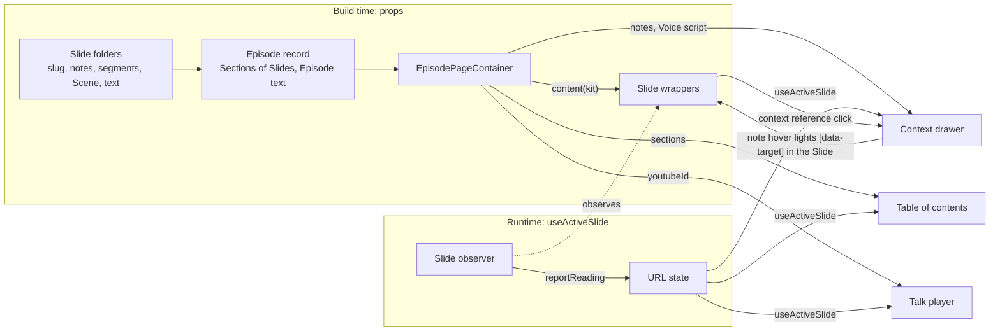

# Episode Page

## Context

Episode = one page: Title slide, then Sections, each a list of Slides whose first, the section slide, names it, beside a table of contents. Every Episode shares this shape, and the Markdown Dossier shares its H1/H2/H3 spine, so a later pipeline can map one onto the other.

**Structure is schema, content is not.** A prototype forced each slide through a typed interface; the agent bent visuals to fit and they degraded. Visualisations need freedom no schema anticipates. One level up it flips: title, Sections, anchors, reading time and table of contents are identical for every Episode, and drift there breaks navigation, translation and the Dossier mapping.

**The Slide is the unit, and the unit is a folder.** A Slide's identity, then its files, once sat in four places and drifted; typed to its Episode, it could not be copied out. Now a Slide is one folder named after its slug, holding its own text; the rest follows by type or position:

```
folder slides/the-lost-middle/, second Slide of Section 'attention'
  → text    slides/the-lost-middle/i18n/{en,de}.json
  → anchor  attention--the-lost-middle
  → heading h3
```

**Reading time is counted, not written.** A hand-written minute count beside a Voice script drifted from it, per locale. Counting the script's words (German reads slower) keeps one source; a Slide without a script shows no time rather than a guess.

**How it fits.**



**The kit** gives a Slide `t` (built from the Slide's own messages; its `t.rich` knows `em`, `b`, `code`), `template`, `ref`, `target`, `slideHref`, `locale` and `Title`.

**Reference implementation: `src/components/episodes/episode-template/`** is the copy source; the frame layouts are in `src/components/slide-master/`, and the Slide library (`slide-master/`) shows the rest. Both are tooling pages, not Episodes (design-ADR 0016). How to write a Slide lives there and in the feature guides.

## Decision

### 1. One container renders every Episode

1. Only `EpisodePageContainer` MAY emit an Episode's slots: Title slide, Sections, anchors, contents, drawer.

### 2. The Slide is the unit

1. Each Slide MUST be one flat folder `slides/<slide>/`, named after its slug: `slide.tsx`, `*.client.tsx`, `*.pure.ts`, CSS module, `i18n/`. `episode.ts` only composes.
2. A Section MUST be a list of Slides, the first, titled, naming it. Anchor `<section>--<slide>`; slugs kebab-case, unique, not `top`; untitled Slides render unlisted.
3. Reading time MUST be counted from Voice script words per locale.

### 3. Scene is free

1. A Scene MUST be free JSX, no slide-type union, reaching the record only via its typed kit.
2. Browser code MUST live in its Slide's folder as `*.client.tsx`.
3. A Slide folder MUST import only its own files, Slide master, `slide-shared`, UI kit, hooks, lib; its `*.client.tsx` only own files, hooks, lib. Shared parts live in `slide-shared`: plain props.

### 4. Headings mirror the Dossier

1. One `h1`: the Episode title. Position sets `h2`/`h3` via the header or `Title`; no Episode file MAY write `h1`–`h3`.

### 5. Strings and anchors keyed by Slide slug

1. A Slide's text MUST live in its own `i18n/<locale>.json`, by role — `title`, not `sections.0.title`; German matches the English shape. Episode text: `<episode>/i18n/`.
2. Published anchors MUST stay (`published-anchors.json`, at publication); `slideHref` MUST name a Slide of it.

### 6. Table of contents and Context drawer read the record

1. Both MUST read Slide data from the record and the active Slide from `useActiveSlide()`, never the DOM.

### 7. Episode styling stays in the Episode

1. `globals.css` MUST hold only tokens Episodes share.
2. A Slide's CSS MUST be a CSS module in its folder (its token file).
3. An Episode MAY keep one stylesheet beside its record, under `[data-episode='<slug>']`, only to remap tokens its chrome reads — `palette.css`.
4. Colour, size and weight MUST use design tokens.

## Do's and Don'ts

### Do's

1. **DO** start an Episode by copying `episode-template/`: rename the slug; add `episode-metadata.ts` and run `npm run registry`; write its `i18n/`; then each Slide as a whole folder (copy one with `cp -r`), listed in its Section's `sections/<section-slug>.ts`, which the record imports in order; at publication, `published-anchors.json`. (Decision 2, Decision 5)
2. **DO** write a Voice script for every Slide the speaker talks over; its words are the reading time. (Decision 2)
3. **DO** leave `title` off a purely visual Slide. (Decision 2)
4. **DO** build a one-off Scene from `SlideFrame`; heading per design-ADR-0012. (Decisions 3 and 4)
5. **DO** mark the element a note explains with `{...target('chart')}`. (Decision 3)
6. **DO** link with `slideHref('the-lost-middle')`; pass a part its strings — `<Statement>{t('statement')}</Statement>`. (Decision 3)
7. **DO** colour _only_ a machine/human/AI meaning with `text-machine`, `text-human`, `text-ai`; check every Slide in both themes. (Decision 7)

### Don'ts

1. **DON'T** render the table of contents, set an anchor `id` or add a route for one Episode. (Decision 1)
2. **DON'T** add a slide-type union or a renderer picking markup from data. (Decision 3)
3. **DON'T** cast a key to make `t`, `ref` or `target` compile. (Decision 3)
4. **DON'T** write `<h2>` in an Episode file. (Decision 4)
5. **DON'T** rename or drop a published slug — it is a shared link. (Decision 2, Decision 5)
6. **DON'T** read a Slide's title, reading time or id from the DOM. (Decision 6)
7. **DON'T** write minutes or segment times by hand — `minutes: { en: 2, de: 2 }`, `from: 0, to: 2`. (Decision 2)
8. **DON'T** hand the kit to a part, or import another Slide or the Episode file from a Slide folder. (Decision 3)
9. **DON'T** add an Episode selector to `globals.css` or a colour with no dark value. (Decision 7)
10. **DON'T** style one Slide from the Episode stylesheet — `.gantt-bar` belongs in its CSS module. (Decision 7)

## Consequences

**Positive:**

1. **Structure right while drafting:** most rules hold by construction or fail in the editor.
2. **Slug written once:** keys, anchor, heading level and kit names follow from it.
3. **One-place change:** a container change reaches every Episode.
4. **Dossier-ready:** fixed spine and stable slugs let a pipeline target the record without touching design.

**Negative:**

1. **Reading time is only as good as the Voice script:** a short or missing script understates it; a fixed words-per-minute rate ignores pauses and demos.
2. **Many small files:** an Episode is a folder of Slide folders, not one page file.
3. **German checked by shape only:** an empty German string compiles; review catches it.

**Risks:**

1. **Structure breaks only visible after build** (duplicate ids, heading order). **Mitigation:** post-build test over every exported Episode, run in CI on every pull request.
2. **A published anchor lost by a rename.** **Mitigation:** the snapshot test names it.
3. **Episode CSS leaking into another page.** **Mitigation:** Slide CSS is a module; the one Episode stylesheet sits under `[data-episode]`; a unit test keeps `[data-episode` out of `globals.css`; reviewer duty.
4. **A copied Slide collides or links outside its Episode.** **Mitigation:** the container throws on both.

## Compliance and Enforcement

1. **Types:** record, registry, kit and Translation files typed; a missing locale, a German Slide file missing an English key, a slug the generated registry does not hold, foreign key, undeclared note or untitled Section opener fails `tsc`.
2. **Unit tests:** the generated registry in step with the Episode folders, so an unregistered folder fails the fast suite; anchor derivation — `top` reserved, duplicate slugs rejected, untitled Slides counted but unlisted; `slideHref` to a slug outside the Episode rejected; every Slide folder named after its slug; reading time from words, 0 hidden; published anchors still produced, and a missing snapshot prints the file to paste.
3. **Lint and dependency rules:** Episode files can't write `h1`–`h3`, carry `'use client'` outside a Slide's `*.client.tsx`, render the table of contents or import the container; a Slide folder reaches only its own files and shared locations; no Episode keeps a `parts/` or `client/` folder; the per-function line cap is off only for Slide server files (complexity and file caps hold; `*.client.tsx` and `*.pure.ts` keep every cap).
4. **Post-build test:** every Episode in every locale — slot order, one `h1`, heading level by position, note targets resolve, no duplicate ids, anchors equal the snapshot, no raw key, reader text equals its capture.

**Manual review duties:** no part reads Slide data from the DOM; a Slide declares only its own names; a part takes plain props; Slide CSS is scoped, the Episode stylesheet only remaps tokens; every Slide looks right in light and dark (screenshots, then a browser); `machine`, `human` and `ai` colour only a machine, human or AI meaning, never a decorative accent.

**Exceptions:** raise a separate ADR; human approval required.

## References

- [`GLOSSARY.md`](../../GLOSSARY.md#episode-structure) — Episode structure: Section, Slide, Scene, Voice script.
- [`docs/features/episode-translation-keys.md`](../../docs/features/episode-translation-keys.md) — key roles, worked examples.
- [`docs/features/episode-migration.md`](../../docs/features/episode-migration.md) — converting a prototype into an Episode, step by step.
- [`docs/adr/0001-the-slide-is-a-self-contained-folder.md`](../../docs/adr/0001-the-slide-is-a-self-contained-folder.md) — why a Slide is a folder.
- [`docs/adr/0008-pipeline-jobs-belong-to-stages.md`](../../docs/adr/0008-pipeline-jobs-belong-to-stages.md) — why each Section is its own `sections/` module.
- [`docs/features/episode-chrome.md`](../../docs/features/episode-chrome.md) — table of contents placement, corner allocation, reserved places.

### Terms

**Slide master**: the shared slide frame and type scale that every Slide layout composes, named after PowerPoint's.

**Slide layout**: one slide design composed from the Slide master, e.g. section slide, basic page slide, three-column page slide.
