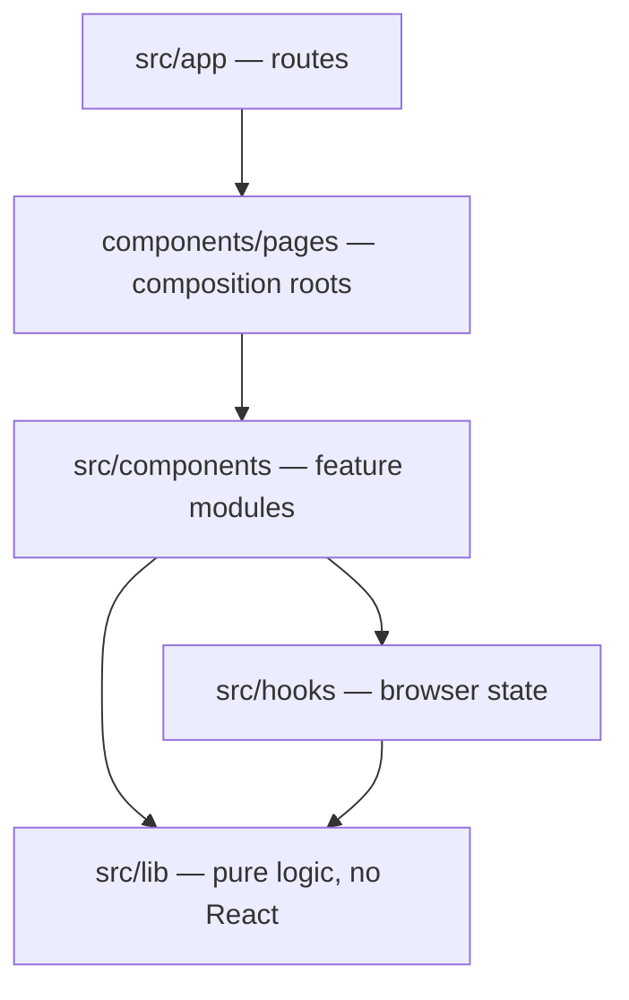
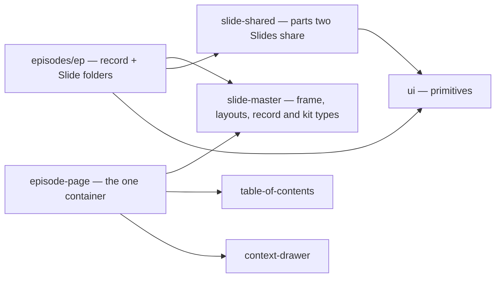
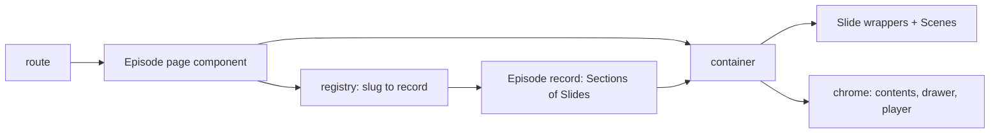
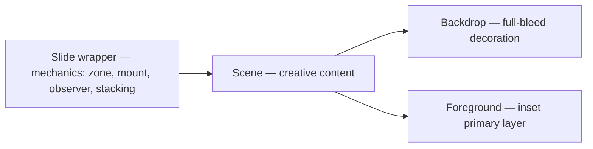
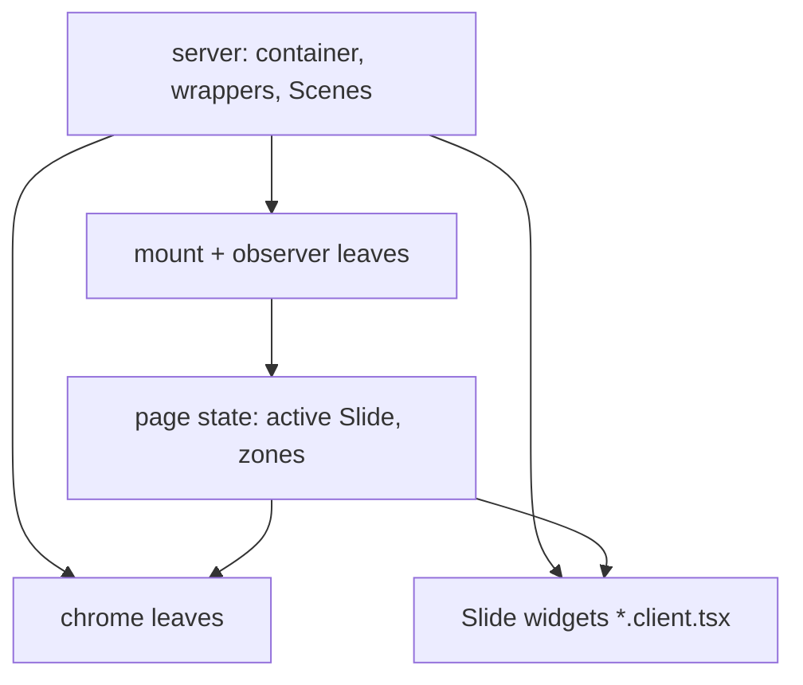

# Slide Architecture

## Context

An agent opening this repo meets five Episode-shaped records, each deep on one concern. None says which module is which or how the parts meet, so an agent guesses, and guesses grow a shared Slide type, a second container or an Episode-local `parts/` folder. This record is the map: shape and ownership only. Each detailed rule lives in the record named under References; on conflict, that record wins.

**Tiers.** Folders are tiers; imports only point down.

**Modules an Episode is built from.** An arrow is an allowed import.

**From Episode to page,** all at build time; the export is static HTML.

**Inside one Slide.** The wrapper owns the mechanics and holds the Scene, which owns the creative content in two layers; the rules are in [Slide Wrapper and Scene](./FE-009-slide-wrapper-and-scene.md).

**Server and client.** The tree is server-rendered; interactivity enters only at leaves, and the leaves meet through URL and page state, never the DOM.

Rejected: one schema for every Slide (visuals bent to fit and degraded); per-Episode containers or routes (navigation, anchors and translation drift apart); a flat package tree (the router owns `src/app` positions, and tiers already carry direction).

For this project the map matters because handoffs run on agents with no session memory: the cheapest correct change is the one the map makes obvious.

## Decision

### 1. This record is the map

1. Read this record before touching an Episode; it names modules and flows, never mechanism. Rules live in the records under References.

### 2. Four tiers, one direction

1. `app → components → hooks → lib`, skips downward only. Routes stay thin and reach components through the page composition roots.

### 3. Each module owns one thing

1. `episodes/<ep>/` owns one Episode: its record (Sections of Slides), its own text, published anchors, and one folder per Slide.
2. A Slide folder owns everything that Slide needs: Scene, widgets, logic, CSS, text, notes, Voice script.
3. `slide-master/` owns the frame, the Slide layouts and the record and kit types; `slide-shared/` owns parts two Slides share, taking plain props.
4. `episode-page/` owns the single container and the Slide mechanics; `table-of-contents/` and `context-drawer/` own the chrome, reached only from the container.

### 4. An Episode becomes a page in one pass

1. Route → page component → registry → record → container → static HTML. One container renders every Episode; anchors and heading levels come from position.

### 5. Text, styling and client code each have fixed homes

1. Text: site-wide Translation files for site chrome and landing; an Episode's folder for its title, caption, description; a Slide's folder for its strings.
2. Styling: site tokens in `globals.css`; an Episode token remap under its own scope; a Slide's look in its own CSS module.
3. Client code: `*.client.tsx` leaves only — in a Slide folder, the container's mechanics or the chrome; hooks hold browser state.

### 6. What an agent may change

1. Free: anything inside a Scene, a new Slide folder, a new Episode copied from the template, a part promoted to `slide-shared`.
2. Only by a new ADR: a tier, a module, a second container or route, a shared Slide shape, a cross-Slide import, a new text or style home.

## Do's and Don'ts

### Do's

1. **DO** start from this map, then open the record that owns the concern. (Decision 1)
2. **DO** add an Episode by copying `page-template/` and registering it. (Decision 3, Decision 4)
3. **DO** add a Slide as one folder, one import and one list entry. (Decision 3)
4. **DO** promote a part a second Slide needs into `slide-shared/`. (Decision 3, Decision 6)
5. **DO** put Slide text in its folder's `i18n/`, Slide CSS in its own module. (Decision 5)
6. **DO** keep interactivity in the smallest `*.client.tsx` leaf. (Decision 5)

### Don'ts

1. **DON'T** import upward, or from one Slide folder into another. (Decision 2, Decision 3)
2. **DON'T** add an Episode-local `parts/` or `client/` folder. (Decision 3)
3. **DON'T** render chrome, anchors or headings outside the container. (Decision 4)
4. **DON'T** put Episode text in the site-wide Translation files. (Decision 5)
5. **DON'T** style a Slide from `globals.css` or the Episode stylesheet. (Decision 5)
6. **DON'T** add a tier, module or Slide schema without a new ADR. (Decision 6)

## Consequences

**Positive:**

1. **One entry point:** an agent learns the whole shape from one short record.
2. **No overlap:** each rule has one owner; the map only points.
3. **Refactor-stable:** module and flow names outlive function renames.
4. **Slides travel:** ownership by folder keeps a Slide copyable.

**Negative:**

1. **Two reads:** a change needs this map plus its owning record.
2. **Restatement:** a few owner rules appear here in summary.
3. **Diagrams by hand:** Mermaid blocks are not generated from the import graph.

**Risks:**

1. **Map drifts from the tree** after a module is added or renamed. **Mitigation:** `files:` globs fail when their folders move; reviewers update this map in the change that adds a module.
2. **Summary contradicts its owner.** **Mitigation:** Decision 1 makes the owner win; review fixes the map.

## Compliance and Enforcement

1. **Dependency rules** (`npm run lint:boundaries`, pre-commit and CI) hold tier direction, Slide-folder and `slide-shared` reach, and chrome reached only from the container.
2. **Lint** holds the `'use client'` classifier; **types** hold the record, registry and per-Slide text; **unit and post-build tests** hold anchors, folder names and slot order.

**Manual review duties:** a new module, tier or text/style home arrives with an ADR and an updated map; diagrams match the tree.

**Exceptions:** raise a separate ADR; human approval required.

## References

- [Episode Page](./FE-002-episode-page.md) — record, Slide folder, headings, strings, Episode styling.
- [Server/Client Boundary](./FE-006-server-client-boundary.md) — `.client` classifier, props across the boundary.
- [Module Layering](./FE-007-module-layering.md) — tiers, thin routes, Slide-folder imports.
- [Slide Wrapper and Scene](./FE-009-slide-wrapper-and-scene.md) — wrapper, mount, observer, Backdrop, stacking.
- [Context Drawer](./FE-010-context-drawer.md) — notes, Voice script, targets.
- [`GLOSSARY.md`](../../GLOSSARY.md) — Episode, Slide, Scene, chrome.
- [`docs/adr/0001-the-slide-is-a-self-contained-folder.md`](../../docs/adr/0001-the-slide-is-a-self-contained-folder.md) — why a Slide is a folder.
- [`docs/features/episode-migration.md`](../../docs/features/episode-migration.md) — building an Episode step by step.
- [Mermaid flowcharts](https://mermaid.js.org/syntax/flowchart.html)
