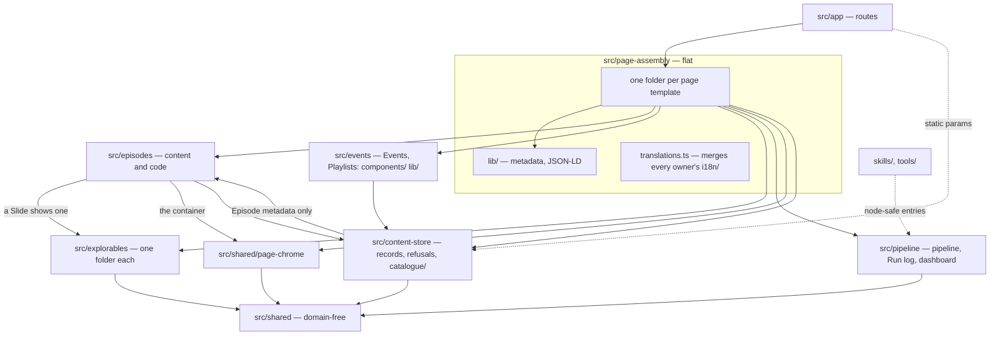
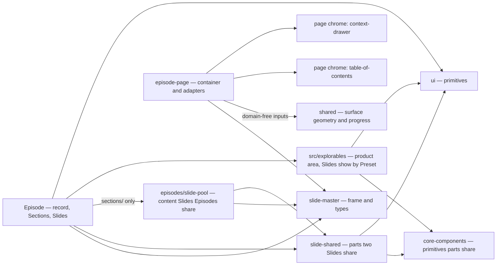
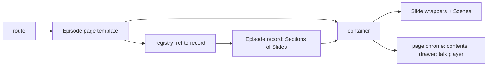
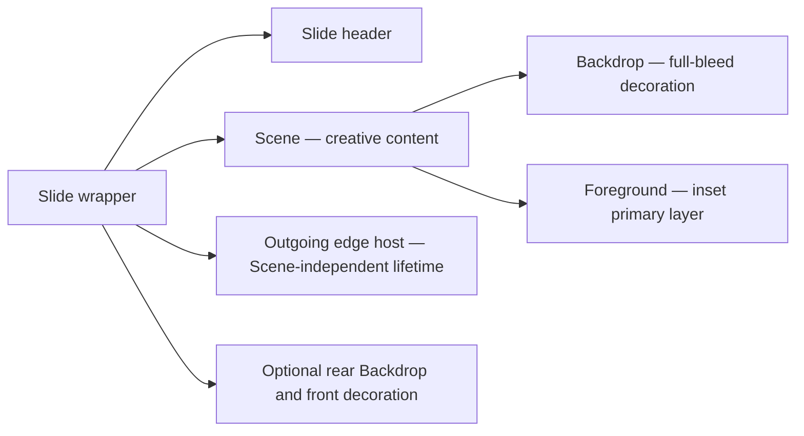
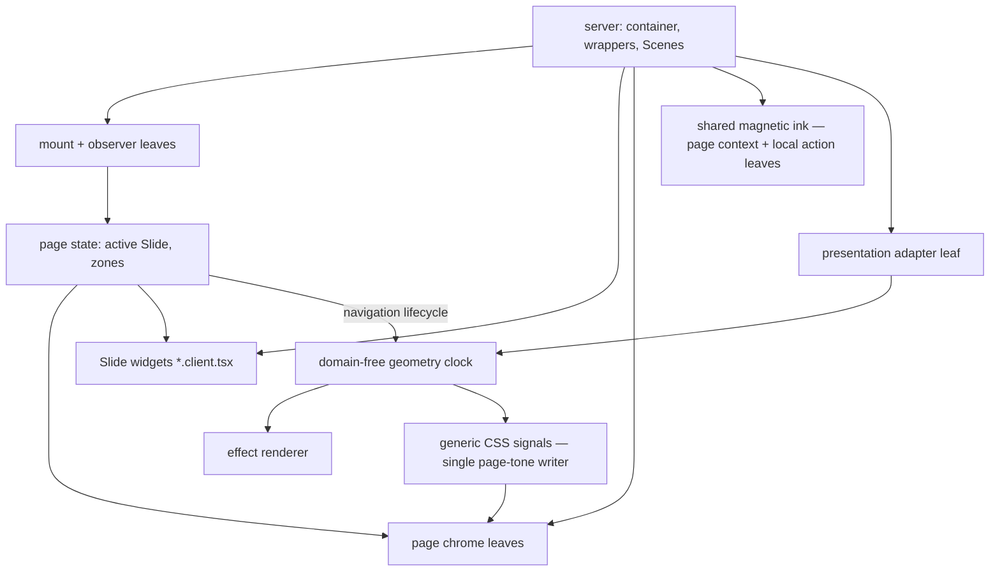

# Slide Architecture

## Context

Map of shape and ownership. Detailed rules stay with their owner: Episode page, imports, server/client boundary, Slide wrapper, Context drawer. On conflict, the owner wins.

**Layers and tiers.** Imports only point down; inside a layer, `components/ → hooks/ → lib/`.

Areas meet in page assembly via props: the Event template passes Episode cards to the Playlist list.

**Episodes:** content (`<ep>/`, `by-event/`, `slide-pool/`, `resources/`) stays apart from code (`components/`, `lib/`, `hooks/`); these names are reserved.

**Episode modules.** Arrows are allowed imports.

**Episode to page:** build-time composition, static HTML.

**Inside a Slide:** wrapper owns mechanics and presentation hosts; Scene owns content. Wrapper rules hold lifetime and stacking.

**Server/client:** interactive leaves only. URL/page state owns identity and navigation; clock/CSS signals own presentation, never DOM-derived identity or tone.

**Magnetic ink:** `shared/components/animations/` draws/styles; `shared/hooks/` attaches/schedules; `shared/lib/` calculates geometry/transitions. Server `SiteShell` composes page context; hosts register locally. Words/navigation stay with their owners. Behaviour: `docs/adr/0022-magnetic-ink-is-a-shared-action-effect.md`.

Rejected: visual schema (constrains Scenes), per-Episode containers (navigation drift), flat packages (lose tier direction).

Ownership is findable without session memory.

## Decision

### 1. This record is the map

1. Read first; each area's owner holds its rules.

### 2. Layers, one direction

1. `app → page-assembly → areas → content-store → shared`, downward only.

### 3. Each module owns one thing

1. `episodes/[by-event/<e>/]<ep>/` owns one Episode: `episode.ts`, text, anchors, Slide folders, `sections/<slug>.ts` per Section.
2. A Slide folder owns its Scene, widgets, logic, CSS, text, notes, Voice script; imports no other.
3. `episodes/slide-pool/<slide>/`: content Slides Episodes share, never Title or section; only a Section imports one, via `@/`.
4. `slide-master/` owns frame, layouts, record, kit and optional presentation types; `slide-shared/`, parts two Slides share.
5. `episode-page/` owns the one container, composition mechanics and page-scoped presentation adapters. Episodes supplies plain inputs to domain-free shared measurement; it knows no Episode or Title. Page chrome is reached only from page assembly or the container.
6. `episodes/templates/<slug>/`: Template composition, including Themes (design-ADR 0026), never an Episode.

### 4. One pass from Episode to page

1. Route → template (by page kind) → registry → record → container → static HTML; anchors from position.
2. Routes: `/episodes/<ep>/`; `/events/`, its `<e>/` and `<e>/episodes/<ep>/`. Resources: `/resources/`, `/<type>/<slug>/`; Themes: `/themes/<slug>/` (design-ADR 0026).

### 5. Text, styling and client code have fixed homes

1. Text: its owner's `i18n/`: page template, area, page chrome, Episode, Slide, Explorable explanation; one owner per namespace.
2. Styling: tokens in `globals.css`; an Episode's remap in its scope; a Slide's in its CSS module.
3. Client code: `*.client.tsx` leaves only; hooks hold browser state.
4. A Slide MAY declare semantic surface tone independently of effects and decorative slots. One container-owned adapter publishes `data-page-tone` on `<html>` from geometry at the supplied viewport sampling line. Page chrome follows; Scenes never style chrome or infer tone from computed colours.

### 6. What an agent may change

1. Free: Title slide notes and Voice script, a Scene, a Slide folder, a templated Episode, a §7 promotion.
2. Only a new ADR: a tier, module, second container, route beyond §4.2, shared Slide shape, text or style home.
3. Optional presentation configuration and the domain-free clock boundary follow `docs/adr/0022-slide-presentation-and-transition-clock.md`. Scene freedom, one container, downward imports and the ADR requirement for other shared-shape/module changes remain binding.

### 7. Where reuse goes

1. By kind:

| Kind               | Home                   |
| ------------------ | ---------------------- |
| Slide, as-is       | Slide pool             |
| Slide to adapt     | Slide library, `cp -r` |
| part               | `slide-shared/`        |
| interactive visual | Explorable explanation |

## Do's and Don'ts

### Do's

1. **DO** start from this map, then open the record that owns the concern. (Decision 1)
2. **DO** add an Episode by copying `episode-template/`, adding its metadata and running `npm run registry`. (Decision 3, Decision 4)
3. **DO** add a Slide as one folder, one import and one list entry in its Section's `sections/<section-slug>.ts`. (Decision 3, design-ADR-0008)
4. **DO** promote a part a second Slide needs into `slide-shared/`, and a whole Slide several Episodes show as-is into the Slide pool, imported by each Section through `@/`. (Decision 3, Decision 7)
5. **DO** put Slide text in its folder's `i18n/`, Slide CSS in its own module. (Decision 5)
6. **DO** keep interactivity in the smallest `*.client.tsx` leaf. (Decision 5)
7. **DO** keep optional presentation types in the Slide master and page-scoped mechanics in the existing container; supply plain inputs to the domain-free clock. (Decision 3, Decision 6)
8. **DO** publish geometry-driven tone through the container's single presentation adapter. (Decision 5)

### Don'ts

1. **DON'T** import upward, or from one Slide folder into another, a pool Slide included. (Decision 2, Decision 3)
2. **DON'T** add an Episode-local `parts/` or `client/` folder, or put a Title or section slide in the Slide pool. (Decision 3)
3. **DON'T** render Slide anchors or headings outside the container, or reach page chrome from anywhere but page assembly or the container. (Decisions 3 and 4)
4. **DON'T** put a published Episode's text in another owner's Translation files. (Decision 5)
5. **DON'T** style a Slide from `globals.css` or the Episode stylesheet. (Decision 5)
6. **DON'T** add a tier, module or Slide schema beyond the approved presentation boundary without a new ADR. (Decision 6)
7. **DON'T** restyle chrome from a Scene or infer semantic tone from computed colours. (Decision 5)
8. **DON'T** let shared measurement import Episode records or Title policy. (Decision 3)

## Consequences

**Positive:**

1. **Entry point:** one map.
2. **No overlap:** one rule owner.
3. **Stable names:** outlive function renames.
4. **Slides travel:** copyable folders.

**Negative:**

1. **Two reads:** map plus owner.
2. **Restatement:** owner rules recur here.
3. **Diagrams by hand:** Mermaid is not generated.
4. **A pool fix travels:** a pool Slide change reaches every Episode that composes it; copy it out first to differ.

**Risks:**

1. **Map drifts from the tree.** **Mitigation:** `files:` globs fail when folders move; reviewers update this map with a new module.
2. **Summary contradicts its owner.** **Mitigation:** Decision 1 makes the owner win; review fixes the map.

## Compliance and Enforcement

1. **Dependency rules** (`npm run lint:boundaries`, pre-commit and CI) hold tier direction, Slide-folder and shared reach, the Section → pool Slide edge and its alias, no pool section slide, and page chrome reached only from page assembly or the container.
2. **Lint** holds the `'use client'` classifier; **types** hold the record, registry and per-Slide text; **unit and post-build tests** hold anchors, folder names, every pool Slide's folder checks and slot order.

**Manual review:** approved module/tier/text/style homes; presentation config governs mechanics, never Scene layout; domain-free measurement; one geometry-driven tone adapter; server defaults and leaf clients. Diagrams express contracts, not completion.

**Exceptions:** raise a separate ADR; human approval required.

## References

- [Presentation boundary and approval](../../docs/adr/0022-slide-presentation-and-transition-clock.md).
- [`GLOSSARY.md`](../../GLOSSARY.md) — Episode, Slide, Scene, Page chrome.
- [Source tree](../../docs/adr/0017-source-tree-follows-the-product.md).
- [Self-contained Slide](../../docs/adr/0001-the-slide-is-a-self-contained-folder.md).
- [Episode authoring](../../docs/features/episode-migration.md).
- [Section modules](../../docs/adr/0008-pipeline-jobs-belong-to-stages.md).
- [Content model and routes](../../docs/adr/0016-content-data-model.md).
- [Shared magnetic ink](../../docs/adr/0022-magnetic-ink-is-a-shared-action-effect.md).
