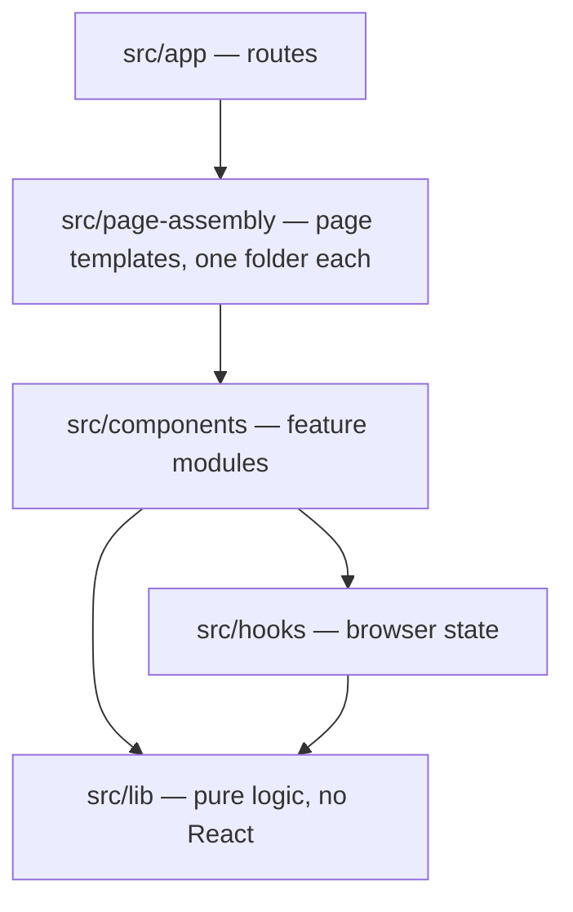
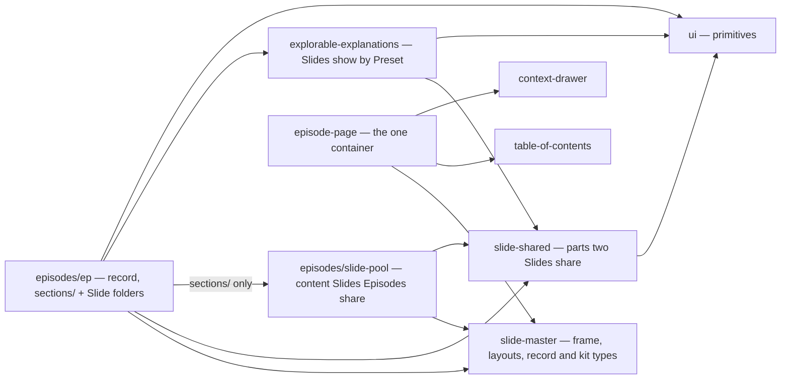
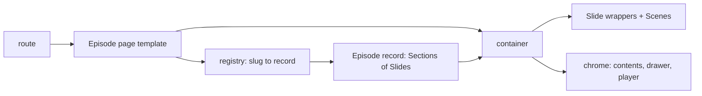
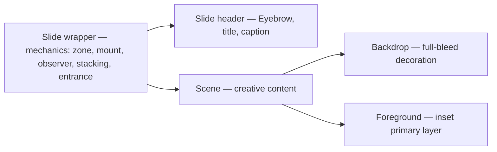
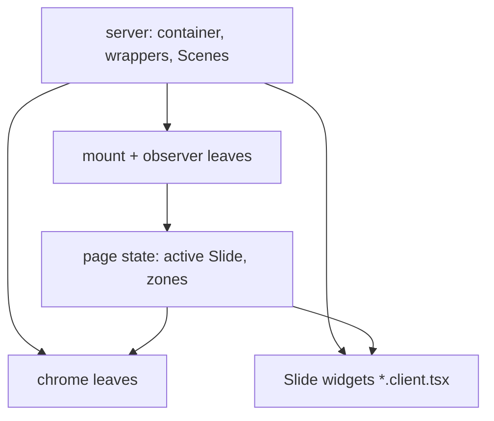

# Slide Architecture

## Context

An agent opening this repo meets five Episode-shaped records, each deep on one concern. None says which module is which or how the parts meet, so an agent guesses, and guesses grow a shared Slide type, a second container or an Episode-local `parts/` folder. This record is the map: shape and ownership only. Each detailed rule lives with the record that owns its area — the Episode page rules (`episodes/`, `slide-master/`, `slide-shared/`), the import boundary (all of `src/`), the server/client boundary (`*.client.tsx`, hooks), the Slide wrapper rules (`episode-page/`, `slide-master/`) and the Context drawer rules (`context-drawer/`); on conflict, that owner wins.

**Tiers.** Folders are tiers; imports only point down.

**Modules an Episode is built from.** An arrow is an allowed import.

**From Episode to page,** all at build time; the export is static HTML.

**Inside one Slide.** The wrapper owns the mechanics and renders the Slide header above the Scene, which owns the creative content in two layers; the Slide wrapper rules, governing `episode-page/` and `slide-master/`, hold the detail.

**Server and client.** The tree is server-rendered; interactivity enters only at leaves, and the leaves meet through URL and page state, never the DOM.

Rejected: one schema for every Slide (visuals bent to fit and degraded); per-Episode containers or routes (navigation, anchors and translation drift apart); a flat package tree (the router owns `src/app` positions, and tiers already carry direction).

For this project the map matters because handoffs run on agents with no session memory: the cheapest correct change is the one the map makes obvious.

## Decision

### 1. This record is the map

1. Read first; each area's owner holds its rules.

### 2. Five tiers, one direction

1. `app → page-assembly → components → hooks → lib`, downward only.

### 3. Each module owns one thing

1. `episodes/[by-event/<e>/]<ep>/` owns one Episode: `episode.ts`, text, anchors, Slide folders, `sections/<slug>.ts` per Section.
2. A Slide folder owns its Scene, widgets, logic, CSS, text, notes, Voice script; imports no other.
3. `episodes/slide-pool/<slide>/`: shared content Slides, never a Title or section slide; only a Section imports one, via `@/`.
4. `slide-master/` owns frame, layouts, record and kit types; `slide-shared/`, parts two Slides share.
5. `episode-page/` owns the one container and Slide mechanics; chrome (`table-of-contents/`, `context-drawer/`) only via it.

### 4. One pass from Episode to page

1. Route → Episode page template (by page kind) → registry → record → container → static HTML; anchors from position.
2. Routes (design-ADR 0016): `/episodes/<ep>/`; `/events/`, its `<e>/` and `<e>/episodes/<ep>/`.

### 5. Text, styling and client code have fixed homes

1. Text: site Translation files for chrome, landing, Upcoming cards; else the owning Episode's, Slide's or Explorable explanation's.
2. Styling: tokens in `globals.css`; an Episode's remap in its scope; a Slide's in its CSS module.
3. Client code: `*.client.tsx` leaves only; hooks hold browser state.

### 6. What an agent may change

1. Free: Title slide notes and Voice script, a Scene, a Slide folder, a templated Episode, a §7 promotion.
2. Only a new ADR: a tier, module, second container, route beyond §4.2, shared Slide shape, text or style home.

### 7. Where reuse goes

1. By kind:

| Kind               | Home                   |
| ------------------ | ---------------------- |
| Slide, as-is       | Slide pool             |
| Slide to adapt     | Slide library, `cp -r` |
| part               | `slide-shared/`        |
| interactive visual | Explorable explanation |

## Do's and Don'ts

### Do's

1. **DO** start from this map, then open the record that owns the concern. (Decision 1)
2. **DO** add an Episode by copying `episode-template/`, adding its metadata and running `npm run registry`. (Decision 3, Decision 4)
3. **DO** add a Slide as one folder, one import and one list entry in its Section's `sections/<section-slug>.ts`. (Decision 3, design-ADR-0008)
4. **DO** promote a part a second Slide needs into `slide-shared/`, and a whole Slide several Episodes show as-is into the Slide pool, imported by each Section through `@/`. (Decision 3, Decision 7)
5. **DO** put Slide text in its folder's `i18n/`, Slide CSS in its own module. (Decision 5)
6. **DO** keep interactivity in the smallest `*.client.tsx` leaf. (Decision 5)

### Don'ts

1. **DON'T** import upward, or from one Slide folder into another, a pool Slide included. (Decision 2, Decision 3)
2. **DON'T** add an Episode-local `parts/` or `client/` folder, or put a Title or section slide in the Slide pool. (Decision 3)
3. **DON'T** render chrome, anchors or headings outside the container. (Decision 4)
4. **DON'T** put a published Episode's text in the site-wide Translation files. (Decision 5)
5. **DON'T** style a Slide from `globals.css` or the Episode stylesheet. (Decision 5)
6. **DON'T** add a tier, module or Slide schema without a new ADR. (Decision 6)

## Consequences

**Positive:**

1. **One entry point:** an agent learns the whole shape from one short record.
2. **No overlap:** each rule has one owner; the map only points.
3. **Refactor-stable:** module and flow names outlive function renames.
4. **Slides travel:** ownership by folder keeps a Slide copyable.

**Negative:**

1. **Two reads:** a change needs this map plus its owning record.
2. **Restatement:** a few owner rules appear here in summary.
3. **Diagrams by hand:** Mermaid blocks are not generated from the import graph.
4. **A pool fix travels:** changing a pool Slide changes every Episode that composes it, past Events' copies included; copy the Slide out first when one Episode needs it different.

**Risks:**

1. **Map drifts from the tree** after a module is added or renamed. **Mitigation:** `files:` globs fail when their folders move; reviewers update this map in the change that adds a module.
2. **Summary contradicts its owner.** **Mitigation:** Decision 1 makes the owner win; review fixes the map.

## Compliance and Enforcement

1. **Dependency rules** (`npm run lint:boundaries`, pre-commit and CI) hold tier direction, Slide-folder and shared reach, the Section → pool Slide edge and its alias, no pool section slide, and chrome reached only from the container.
2. **Lint** holds the `'use client'` classifier; **types** hold the record, registry and per-Slide text; **unit and post-build tests** hold anchors, folder names, every pool Slide's folder checks and slot order.

**Manual review duties:** a new module, tier or text/style home arrives with an ADR and an updated map; diagrams match the tree.

**Exceptions:** raise a separate ADR; human approval required.

## References

- [`GLOSSARY.md`](../../GLOSSARY.md) — Episode, Slide, Scene, chrome.
- [`docs/adr/0001-the-slide-is-a-self-contained-folder.md`](../../docs/adr/0001-the-slide-is-a-self-contained-folder.md) — why a Slide is a folder.
- [`docs/features/episode-migration.md`](../../docs/features/episode-migration.md) — building an Episode step by step.
- [`docs/adr/0008-pipeline-jobs-belong-to-stages.md`](../../docs/adr/0008-pipeline-jobs-belong-to-stages.md) — why each Section is its own `sections/` module.
- [`docs/adr/0016-content-data-model.md`](../../docs/adr/0016-content-data-model.md) — the Event routes and the Event-scoped Episode page (§4.2).
- [Mermaid flowcharts](https://mermaid.js.org/syntax/flowchart.html)
