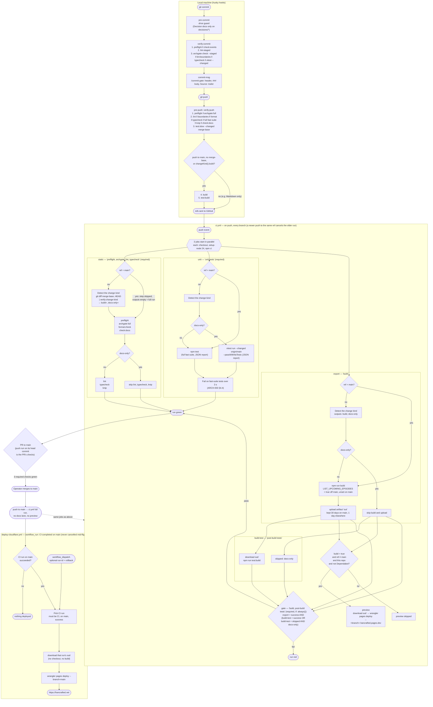
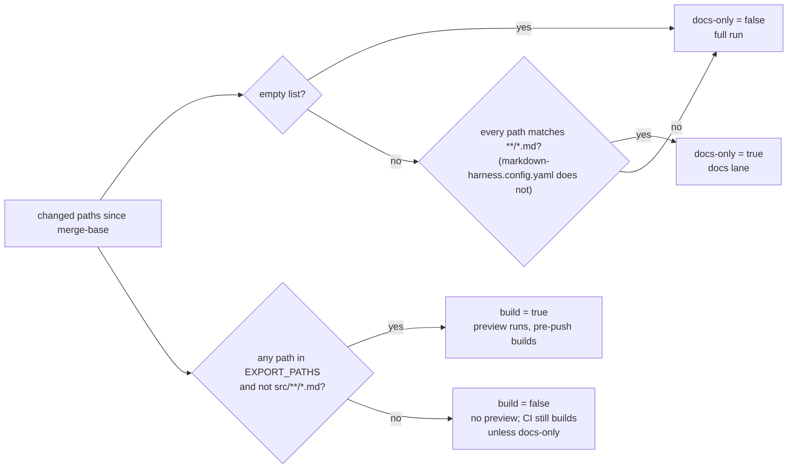
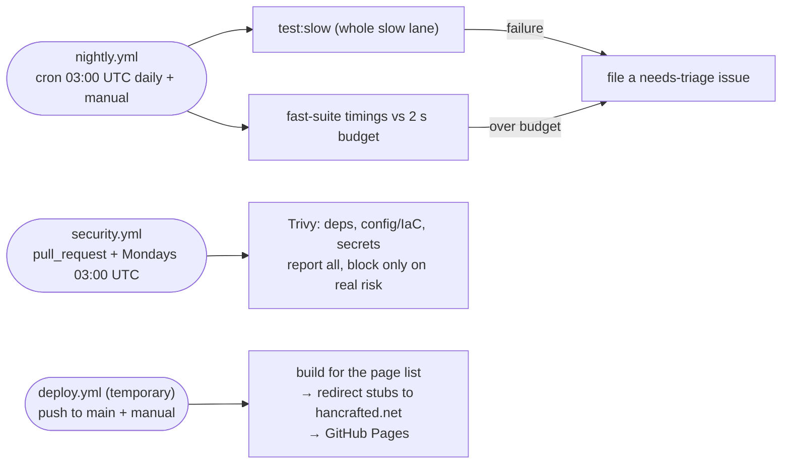

# CI

How a change travels from a local commit to https://hancrafted.net, as of PR #781 (the docs lane). The workflows are the source of truth: `.github/workflows/ci.yml`, `deploy-cloudflare.yml`, `nightly.yml`, `security.yml`, `deploy.yml`; the local hooks are `.husky/pre-commit` and `.husky/pre-push` (plans in `tools/verify/verify.pure.ts`). The prose reference is `docs/features/hosting.md`.

## From commit to production

## The change kind

Every push off `main` is classified once per job by `npm run -s verify:change-kind` (`tools/verify/change-kind.pure.ts`) over the paths changed since the merge-base with `origin/main`.

| Lane                       | static                                       | unit                    | export        | post-build tests | preview |
| -------------------------- | -------------------------------------------- | ----------------------- | ------------- | ---------------- | ------- |
| `main`                     | all                                          | full suite              | build, 30-day | runs             | never   |
| branch, export input       | all                                          | full suite              | build, 1-day  | runs             | yes     |
| branch, other non-Markdown | all                                          | full suite              | build, 1-day  | runs             | no      |
| branch, Markdown only      | preflight, archgate:full, format, check:docs | `--changed origin/main` | skipped       | skipped          | no      |

## Scheduled and side workflows

