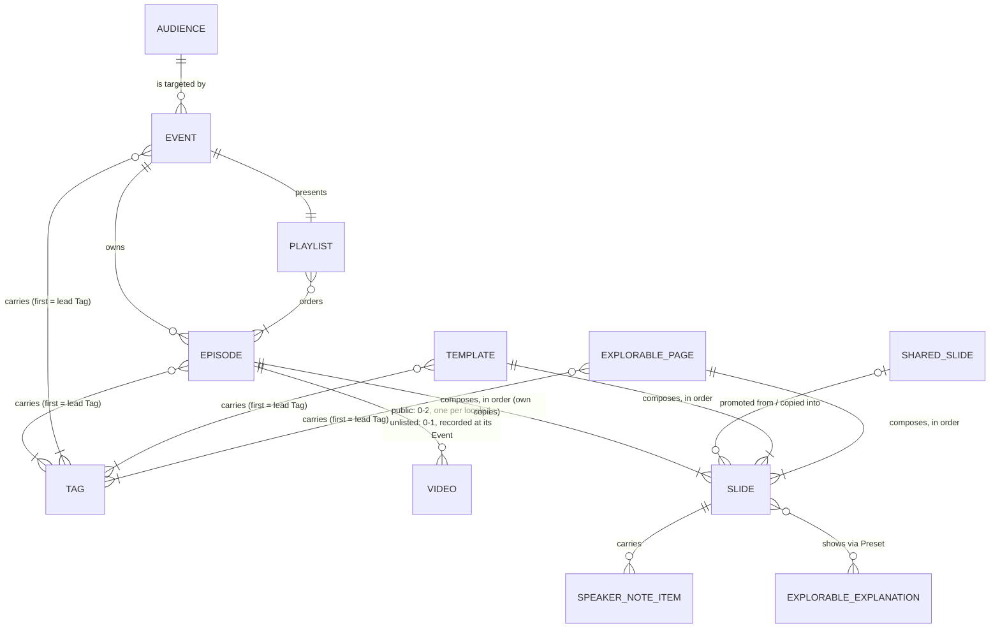

# Content data model

Amended by #404 (terminology and paths): "Explorable explanation" is now **Explorable**, and the `EXPLORABLE_EXPLANATION` entity of the model is the Explorable. The old Resource record kind is now the **Template** (types `episode-template` and `master-slide`), and **Resource** is the umbrella for every public, listed item (GLOSSARY). In decision 12, `episodes/resources/<slug>/` is now `episodes/templates/<slug>/` for Templates and `episodes/explorable-pages/<slug>/` for Explorable pages, whose record kind is its own. Read the body below with those terms and paths.

The site described a workshop as a Workshop: one record listing public Episode slugs. It could not hold what was presented at an Event, so an Event recording had nowhere to live; nothing stopped a page meant for attendees from reaching the sitemap; and the four authoring pages sat in the Episode registry, indexed, as if a viewer watched them. This record fixes the content model for horizons 1 and 2 of `docs/steering/product-vision.md`, without the evidence layer, and the delivery contract the Tuesday epic implements.

Settled live with Han on 2026-10-25, in ticket _Delivery contract: Event, Playlist, routes and visibility_ and a grill of this record (map _Content data model and product vision_). The enforceable part lives in the Archgate ADR FE-013 _Content store_; what each unit is for, per Audience, lives in `docs/steering/product-requirements.md`.

## Model

Entities and relationships only, never fields: a renamed property never changes this diagram. `%% planned` marks an entity of horizon 2 that does not exist in code yet. `%% store` lists the entities the content store loads as records; FE-013 fails when that list and the store's schemas disagree.

A Playlist that no Event presents is a public Playlist (horizon 2); the diagram draws one Playlist entity for both kinds.

Out of the model: Concept, Research question and Source (the evidence layer, its own effort, which then replaces Tags); progress, Programme and people data (horizon 3; ids stay stable for them).

## Decisions

### Teaching

1. **An Episode is standalone.** A container of Slides with its own title, Slides and Videos, whether public or unlisted.
2. **Every Episode declares `visibility`: `public` or `unlisted`.** A record without it is refused, so a forgotten field fails closed. Flipping it is the one edit that moves an Episode between the two; pages, sitemap and overview follow.
3. **Every Episode is registered once**, whatever its visibility, by its **Episode id**: derived from its folder, never written in its record. An Episode no Event owns sits in `episodes/<slug>/` and its id is its slug; an Event's copy sits in `episodes/by-event/<event-slug>/<slug>/` and its id is `<event-slug>__<slug>`. A slug is unique among its siblings, so a copy usually keeps its original's; the id is unique across all Episodes. `by-event` is a reserved folder name, never a slug. Code passes an `EpisodeRef` (standalone or Event copy) and branches on it with `matchEpisode`: the store reads each id into its EpisodeRef once, when the records load, and serves it with every Episode, Playlist entry and Episode page.
4. **An unlisted Episode lives only under an Event**, in that Event's folder: one outside `by-event/`, or one that no Event's Playlist lists, is refused. It has no overview card and is never an Upcoming Episode. Unlisted is not private: anyone holding the URL can open it. A public copy in an Event's folder lives at its Event-scoped URL only, with no `/episodes/` page.
5. **A Video is a YouTube video; visibility decides how many.** A public Episode has at most one per locale: none, English, German or both. An unlisted Episode has at most one, recorded at its Event in the language spoken there, played on both locale pages and labelled with that language: the recording belongs to the composition that was presented.
6. **Slides are copied, then promoted deliberately** (vision rule 4). Reusing a Slide copies its folder into the Episode, slug kept (_The Slide is a self-contained folder_). Copies drift until Han promotes one to a **Shared Slide**. How promotion works is open in ticket _Slide reuse_.
7. **Tags group Episodes and Events** as _Tags replace Topics_ decides, until the evidence layer replaces them; an Event carries its own Tags, curated, never worked out from its Playlist (_Events overview_).

### Delivery

8. **An Event** is a dated workshop or webinar: slug `<date>-<name>`, date, kind, the Audience it targets, its **Organizers** (a tuple of one or more ids from a closed list, lead first, as Tags are; the registry `ORGANIZERS` gives each its name and url), its Tags (lead Tag first, as an Episode's), optional time, where it takes place (a format of onsite, remote or hybrid, with a venue onsite and hybrid and a platform from a closed list remote and hybrid; amended by _Events overview_), and the one Playlist it presents. It may also carry a `listing` (the partner's own page for the Event), `references` (`label` and url pairs, the label the same in every locale) and an `image` (a path under `/images/events/` with a credit; its alt is a Translation key by Event slug); every URL is `https`. Sponsors are not modelled. It owns its copies of Episodes, each in its folder `by-event/<event-slug>/`, and its Playlist lists Episodes no Event owns and its own copies, never another Event's. It owns no Slides directly, holds no text (title and description are Translation keys, FE-003) and has no visibility of its own. A copy that moves under its Event keeps its old Event-scoped URL as a 301 in `public/_redirects`.
9. **A Playlist** is an ordered list of **Playlist entries** and its `visibility`, nothing else (amended 2026-10-27 for the CyberForum check-ins). An entry is an Episode id, or `{ episode, anchor }` for a place in it; without an anchor it opens the Episode's top. An Episode may be listed again, at an anchor or not, so a wrapper Episode such as the intro can return between the others. Every entry is a numbered step and "n of m" counts them all, while the Event card's Episode count counts distinct Episodes, since a check-in is a place in one, not another (CyberForum: "Episode 1 of 7", "4 Episodes"); an anchored entry's card shows the title of the Section its anchor names, no caption, Tags or date. An Episode's page under the Event takes its place from its first entry, and the walk from one Episode to the next steps over entries listing an Episode again; the store marks those `repeat` once, for every reader. A test holds every anchor to a Section of its Episode. Whether it is an event Playlist is read from the Event side. A public Playlist lists only public Episodes; an event Playlist may list unlisted ones. `attendees` is refused until horizon 3 gives it an enforcer.
10. **The Workshop template** replaces the event-frame Episode: a copy source holding title, agenda, in-scope, out-of-scope and orga Slides, copied into an ordinary unlisted Episode placed first in an Event's Playlist. A `/new-event` skill waits until two real Events exist.

### Records

11. **Every record loads through one content store** that parses each with a Zod schema and applies the cross-record refusals of decisions 2, 4 and 9; pages, routes, sitemap and metadata read records only through it. The rules are FE-013 _Content store_.
12. **Resources are not Episodes** (amended by _Resources overview_; the Explorable pages left for their own record kind, `EXPLORABLE_PAGE`, a slug that names its primary Explorable, Tags, a visibility and an optional `youtube`, composed from `episodes/explorable-pages/<slug>/`, served at `/explorables/<slug>/`, spec #404): the Episode template and the Workshop template, and the Timelines and Grids Master slides. A Resource is a record of its own, a slug, a type from the closed `TEMPLATE_TYPES`, Tags and a visibility, and is composed like an Episode from `episodes/resources/<slug>/`; it is not loaded as an Episode record. Its route is worked out from type and slug, and it is public and indexed.
13. **`slide-layouts` is deleted.** Its three layouts exist as frame components; the Slide library is the one catalogue of layouts.

## Routes and visibility

| URL (`/de` prefix for German)                   | What it is                                                                    |
| ----------------------------------------------- | ----------------------------------------------------------------------------- |
| `/events/`                                      | Events whose Playlist is public. Replaces `/workshops/`.                      |
| `/events/<event-slug>/`                         | The Event: facts, past notice, its Playlist entries as numbered cards.        |
| `/events/<event-slug>/episodes/<episode-slug>/` | One Episode of that Playlist: "Episode n of m", previous and next.            |
| `/episodes/<episode-slug>/`                     | A public Episode no Event owns. An Event's copy has none.                     |
| `/resources/`                                   | The Resources: Episode templates, Master slides.                              |
| `/explorables/`                                 | The Explorable pages.                                                         |
| `/explorables/<slug>/`                          | One Explorable page, its slug its primary Explorable's folder slug.           |
| `/<type plural>/<resource-slug>/`               | One Resource, by its type's plural: `/episode-templates/`, `/master-slides/`. |

The Event page sits in the same container as the overview pages and is two columns from `lg`, no longer one. The main column holds the title, description, past notice, Start button, Playlist and, last, up to three related Episodes: public, published Episodes sharing a Tag with the Event, without the originals of the Playlist's copies, newest release first, and no section when none remain. The side panel holds the image, the facts line stacked, the Organizers, a link to the `listing` and the `references`. Below `lg` everything stacks, the image after the title. The Event page shows no reading time.

Old `/workshops/` URLs 301 to their Event in `public/_redirects`, both locales (FE-005 forbids `next.config.ts` redirects).

One predicate decides each page's sitemap entry, robots tag and canonical, and both the page metadata and the sitemap ask it (FE-008):

| Page                              | Sitemap | Robots    | Canonical                    |
| --------------------------------- | ------- | --------- | ---------------------------- |
| Public, published Episode         | yes     | index     | itself, with hreflang        |
| Event page, public Playlist       | yes     | index     | itself, with hreflang        |
| Event page, unlisted Playlist     | no      | `noindex` | itself                       |
| Unlisted Episode under its Event  | no      | `noindex` | itself                       |
| Public Episode under an Event     | no      | index     | its `/episodes/<slug>/` page |
| Public Event copy under its Event | yes     | index     | itself, with hreflang        |
| Upcoming Episode, anywhere        | no      | `noindex` | itself                       |
| Resources overview                | yes     | index     | itself, with hreflang        |
| Resource page, public             | yes     | index     | itself, with hreflang        |
| Resource page, unlisted           | no      | `noindex` | itself                       |

`noindex` is a meta tag only; `robots.txt` keeps `allow: /` so a crawler can read it.

**Past Event.** Past means its date lies before the build day: derived, never stored. References are live and never pinned, so a past Event shows the Episodes as they are today, with one fixed notice that the content may differ from the recording: above the Playlist on the Event page and above the title on each Event-scoped Episode page, never on `/episodes/`.

## Considered options

| Option                                                    | Why not                                                                                                                                                   |
| --------------------------------------------------------- | --------------------------------------------------------------------------------------------------------------------------------------------------------- |
| An event-frame Episode type for agenda and orga           | A second kind of Episode with its own rules; a template copied into an ordinary unlisted Episode does the same with none.                                 |
| `canonicalEpisode` on an unlisted Episode copied from one | Needed only to share ranking with a page that stays `noindex` anyway; one more field to keep honest.                                                      |
| A stored Playlist `type: event \| standard`               | States the Event link twice and checks one copy against the other; no standard Playlist exists before horizon 2.                                          |
| Reusing Slides by reference from first reuse              | Promotion becomes a merge, untouched copies miss fixes for weeks, and a promotion moves published anchors. Copying keeps the architecture plain.          |
| Separate entities for a Video and an Event recording      | Both are a YouTube video; count and language follow from visibility, so a second entity only repeats it.                                                  |
| The model as the full target, evidence included           | A box an agent cannot find in code costs a search; the evidence layer is its own effort and adds its section then.                                        |
| The model and its rules in one Archgate ADR               | The model changes with features, which fails GEN-001's altitude test, and an Archgate ADR may not link to its reasons.                                    |
| Tooling pages as public Episodes                          | They would enter every Episode list, and the overview needs a second rule to hide them. A Resource is a record of its own instead (_Resources overview_). |

## Consequences

- An Event is one Event record, one Playlist record, an unlisted copy of the Workshop template and two Translation keys; routes, sitemap and static params follow.
- Adding a recording is one YouTube id on its Episode.
- The Episode registry shrinks to Episodes; the Resources get their own list and records (_Resources overview_).
- Each later effort (Slide reuse, the evidence layer, the first public Playlist) amends this record with its own section and redraws the diagram.
