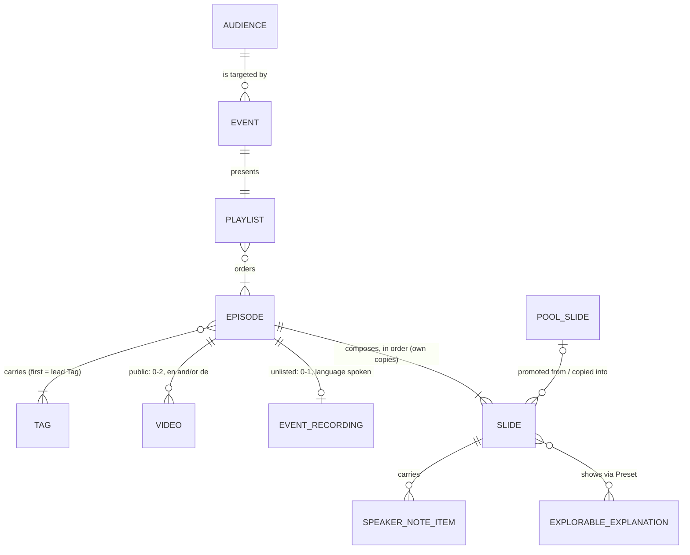

# Content data model

The site described a workshop as a Workshop: one record listing public Episode slugs. It could not hold what was presented at an Event, so an Event recording had nowhere to live; nothing stopped a page meant for attendees from reaching the sitemap; and the four authoring pages sat in the Episode registry, indexed, as if a viewer watched them. This record fixes the content model for horizons 1 and 2 of `docs/steering/product-vision.md`, without the evidence layer, and the delivery contract the Tuesday epic implements.

Settled in the map _Content data model and product vision_: ticket _Delivery contract: Event, Playlist, routes and visibility_ (Han, live, 2026-10-25), then a grill of this record (Han, live, 2026-10-25). It amends decision 5 of _Tags replace Topics_. The enforceable part lives in the Archgate ADR FE-013 _Content store_; what each unit is for, per Audience, lives in `docs/steering/product-requirements.md`.

## Model

Entities and relationships only, never fields: a renamed property never changes this diagram. `%% planned` marks an entity of horizon 2 that does not exist in code yet. `%% store` lists the entities the content store loads as records; FE-013 fails when that list and the store's schemas disagree.

A Playlist that no Event presents is a public Playlist (horizon 2); the diagram draws one Playlist entity for both kinds.

Out of the model: Concept, Research question and Source (the evidence layer, its own effort, which then replaces Tags); progress, Programme and people data (horizon 3; ids stay stable for them).

## Decisions

### Teaching

1. **An Episode is standalone.** A container of Slides with its own title, Slides and videos, whether public or unlisted. No Episode `type`, no event-frame Episode, no canonical Episode.
2. **`visibility` is an Episode's only new field: `public` or `unlisted`, required.** A record without it is refused, so a forgotten field fails closed. Flipping it is the one edit that moves an Episode between the two; pages, sitemap and overview follow.
3. **Every Episode is registered once**, whatever its visibility. Episode slugs are unique across all Episodes.
4. **An unlisted Episode lives only under an Event.** One that no Event's Playlist lists is refused. It has no `/episodes/` page, no overview card and is never an Upcoming Episode. Unlisted is not private: anyone holding the URL can open it.
5. **Video and Event recording are two things.** A public Episode has a **Video** per locale, none, English, German or both, made for the channel. An unlisted Episode has at most one **Event recording**, in the language spoken at its Event, played on both locale pages and labelled with that language. The recording belongs to the composition that was presented.
6. **Slides are copied, then promoted deliberately** (vision rule 4). Reusing a Slide copies its folder into the Episode, slug kept (_The Slide is a self-contained folder_). Copies drift until Han promotes one to the shared pool. How promotion works is open in ticket _Slide reuse_.
7. **Tags group Episodes** as _Tags replace Topics_ decides, until the evidence layer replaces them.

### Delivery

8. **An Event** is a dated workshop or webinar: slug `<date>-<name>`, date, kind, the Audience it targets, optional time and location, and the one Playlist it presents. It owns no Slides, holds no text (title and description are Translation keys, FE-003) and has no visibility of its own.
9. **A Playlist** is an ordered list of Episodes and its `visibility`, nothing else. Whether it is an event Playlist is read from the Event side, never stored on it: a Playlist knows no Event. A public Playlist lists only public Episodes; an event Playlist may list unlisted ones. `attendees` is refused until horizon 3 gives it an enforcer.
10. **The Workshop template** replaces the event-frame Episode: a copy source holding title, agenda, in-scope, out-of-scope and orga Slides, copied into an ordinary unlisted Episode placed first in an Event's Playlist. A `/new-event` skill waits until two real Events exist.

### Records

11. **Every record loads through one content store** that parses each with a Zod schema and applies the cross-record refusals of decisions 2, 4 and 9; pages, routes, sitemap and metadata read records only through it. The rules are FE-013 _Content store_.
12. **Tooling pages are not Episodes**: the Episode template, the Workshop template, the Explorable explanations page and the Slide library (`slide-master`). They carry no visibility, are not loaded as Episode records, keep their URLs, and are `noindex` and out of the sitemap. `slide-layouts` is deleted: its layouts exist as frame components.

## Routes and visibility

| URL (`/de` prefix for German)                   | What it is                                                         |
| ----------------------------------------------- | ------------------------------------------------------------------ |
| `/events/`                                      | Events whose Playlist is public. Replaces `/workshops/`.           |
| `/events/<event-slug>/`                         | The Event: facts, past notice, its Playlist as numbered cards.     |
| `/events/<event-slug>/episodes/<episode-slug>/` | One Episode of that Playlist: "Episode n of m", previous and next. |
| `/episodes/<episode-slug>/`                     | A public Episode, unchanged. An unlisted Episode has none.         |

Old `/workshops/` URLs 301 to their Event in `public/_redirects`, both locales (FE-005 forbids `next.config.ts` redirects).

One predicate decides each page's sitemap entry, robots tag and canonical, and both the page metadata and the sitemap ask it (FE-008):

| Page                             | Sitemap | Robots    | Canonical                    |
| -------------------------------- | ------- | --------- | ---------------------------- |
| Public, published Episode        | yes     | index     | itself, with hreflang        |
| Event page, public Playlist      | yes     | index     | itself, with hreflang        |
| Event page, unlisted Playlist    | no      | `noindex` | itself                       |
| Unlisted Episode under its Event | no      | `noindex` | itself                       |
| Public Episode under an Event    | no      | index     | its `/episodes/<slug>/` page |
| Upcoming Episode, anywhere       | no      | `noindex` | itself                       |
| Tooling page                     | no      | `noindex` | itself                       |

`noindex` is a meta tag only; `robots.txt` keeps `allow: /` so a crawler can read it.

**Past Event.** Past means its date lies before the build day: derived, never stored. References are live and never pinned, so a past Event shows the Episodes as they are today, with one fixed notice that the content may differ from the recording: above the Playlist on the Event page and above the title on each Event-scoped Episode page, never on `/episodes/`.

## Considered options

| Option                                                    | Why not                                                                                                                                          |
| --------------------------------------------------------- | ------------------------------------------------------------------------------------------------------------------------------------------------ |
| An event-frame Episode type for agenda and orga           | A second kind of Episode with its own rules; a template copied into an ordinary unlisted Episode does the same with none.                        |
| `canonicalEpisode` on an unlisted Episode copied from one | Needed only to share ranking with a page that stays `noindex` anyway; one more field to keep honest.                                             |
| A stored Playlist `type: event \| standard`               | States the Event link twice and checks one copy against the other; no standard Playlist exists before horizon 2.                                 |
| Reusing Slides by reference from first reuse              | Promotion becomes a merge, untouched copies miss fixes for weeks, and a promotion moves published anchors. Copying keeps the architecture plain. |
| One Recording term for both videos                        | They differ in count, language and making; one name invites a German Event recording.                                                            |
| The model as the full target, evidence included           | A box an agent cannot find in code costs a search; the evidence layer is its own effort and adds its section then.                               |
| The model and its rules in one Archgate ADR               | The model changes with features, which fails GEN-001's altitude test, and an Archgate ADR may not link to its reasons.                           |
| Tooling pages as public Episodes                          | Catalogue pages stay in search, and the overview needs a second rule to hide them.                                                               |

## Consequences

- An Event is one Event record, one Playlist record, an unlisted copy of the Workshop template and two Translation keys; routes, sitemap and static params follow.
- Adding an Event recording is one field on an unlisted Episode.
- The Episode registry shrinks to Episodes; the four tooling pages get their own list.
- Each later effort (Slide reuse, the evidence layer, the first public Playlist) amends this record with its own section and redraws the diagram.
