# Never too early to start with sales, source deck

## Page 1

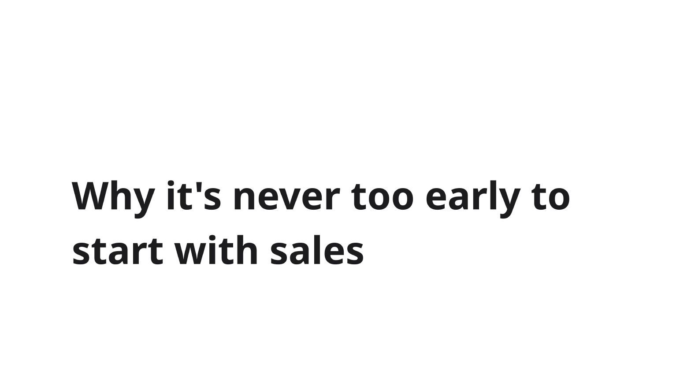

**Why it's never too early to  
start with sales**

## Page 2

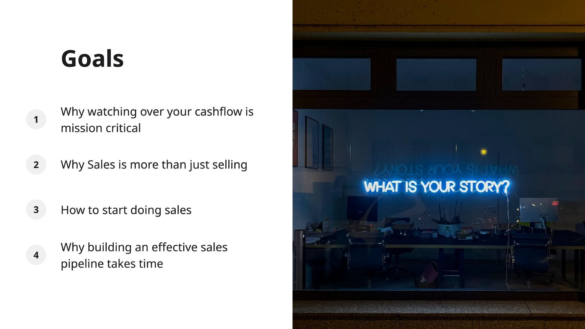

### Goals

1. Why watching over your cashflow is mission critical
2. Why Sales is more than just selling
3. How to start doing sales
4. Why building an effective sales pipeline takes time

## Page 3

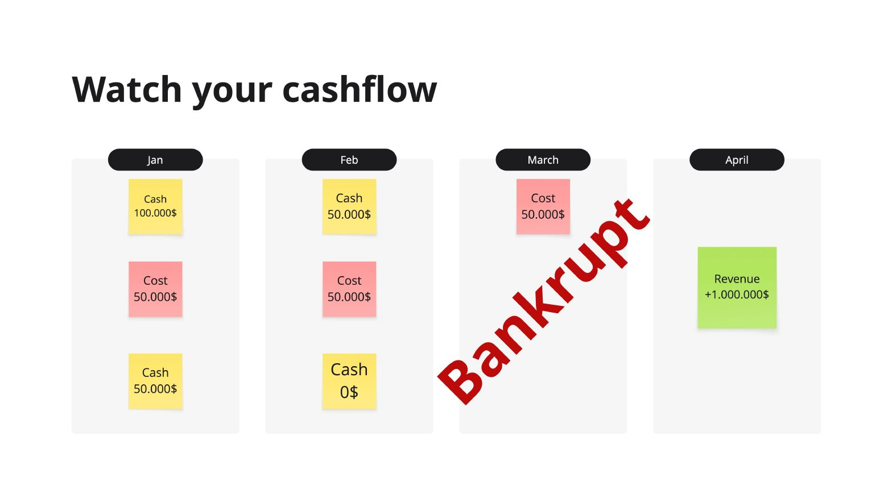

### Watch your cashflow

Jan

Cash  
100.000\$

Cost  
50.000\$

Cash  
50.000\$

Feb

Cash  
50.000\$

Cost  
50.000\$

Cash  
0\$

March

Cost  
50.000\$

April

Revenue  
+1.000.000\$

**Bankrupt**

## Page 4

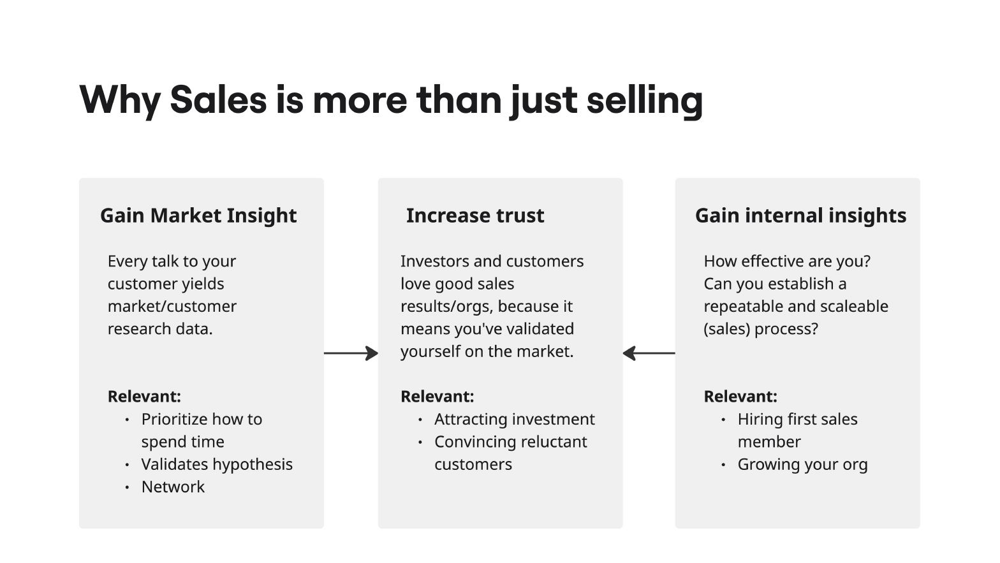

### Why Sales is more than just selling

#### Gain Market Insight

Every talk to your customer yields market/customer research data.

##### Relevant:

- Prioritize how to spend time
- Validates hypothesis
- Network

#### Increase trust

Investors and customers love good sales results/orgs, because it means you've validated yourself on the market.

##### Relevant:

- Attracting investment
- Convincing reluctant customers

#### Gain internal insights

How effective are you?  
Can you establish a repeatable and scaleable (sales) process?

##### Relevant:

- Hiring first sales member
- Growing your org

## Page 5

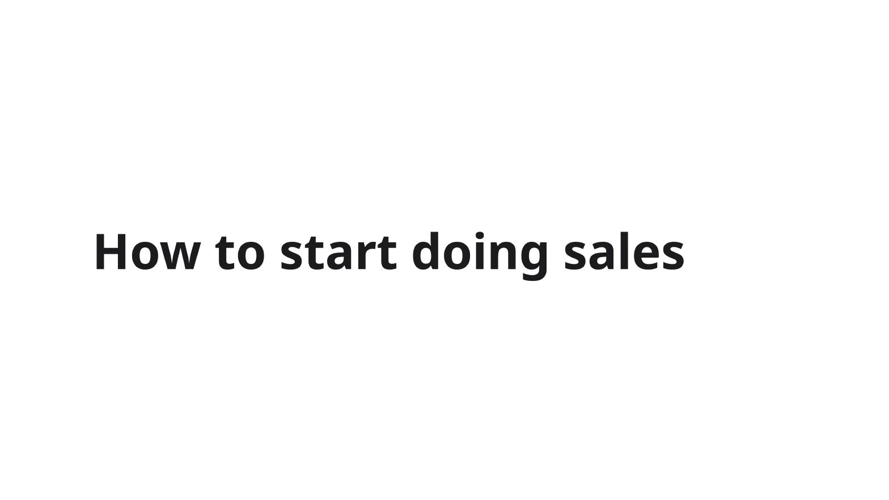

### How to start doing sales

## Page 6

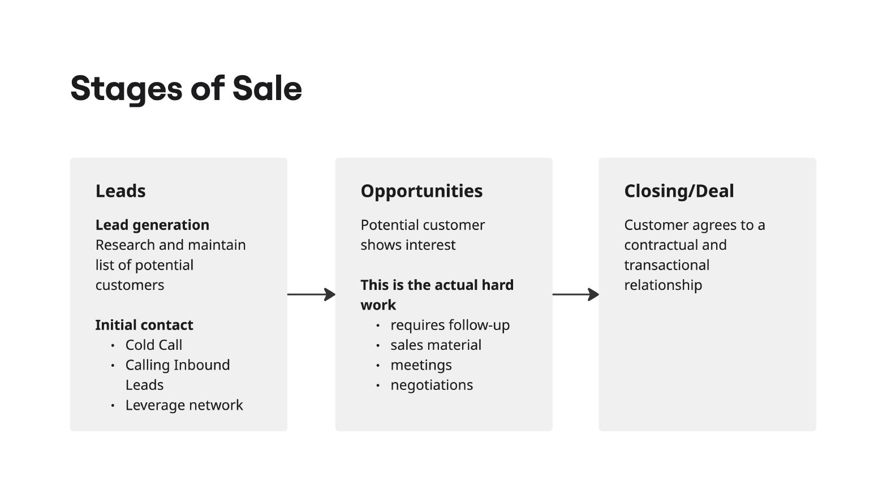

### Stages of Sale

#### Leads

##### Lead generation

Research and maintain list of potential customers

##### Initial contact

- Cold Call
- Calling Inbound Leads
- Leverage network

#### Opportunities

Potential customer shows interest

##### This is the actual hard work

- requires follow-up
- sales material
- meetings
- negotiations

#### Closing/Deal

Customer agrees to a contractual and transactional relationship

## Page 7

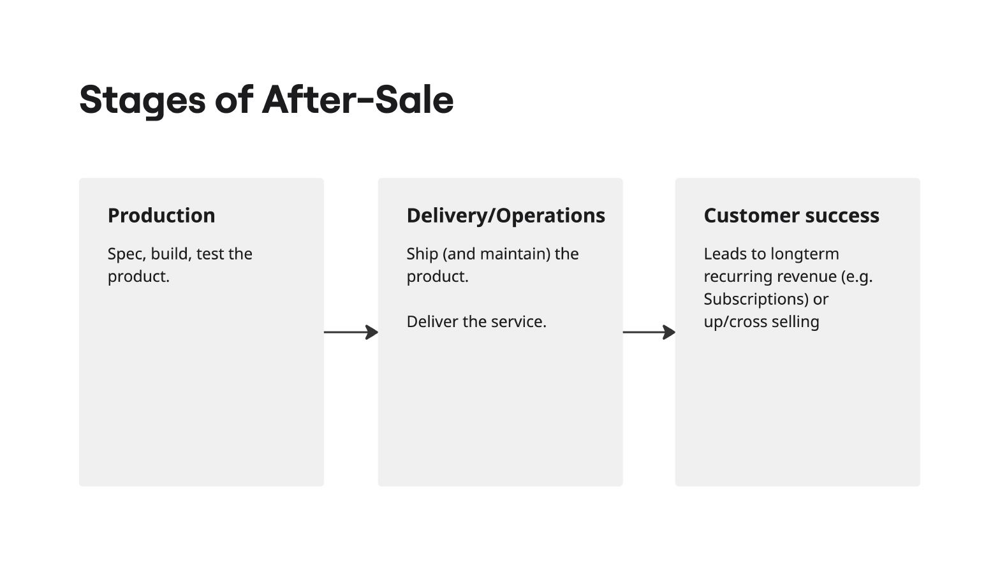

### Stages of After-Sale

#### Production

Spec, build, test the product.

#### Delivery/Operations

Ship (and maintain) the product.

Deliver the service.

#### Customer success

Leads to longterm recurring revenue (e.g. Subscriptions) or up/cross selling

## Page 8

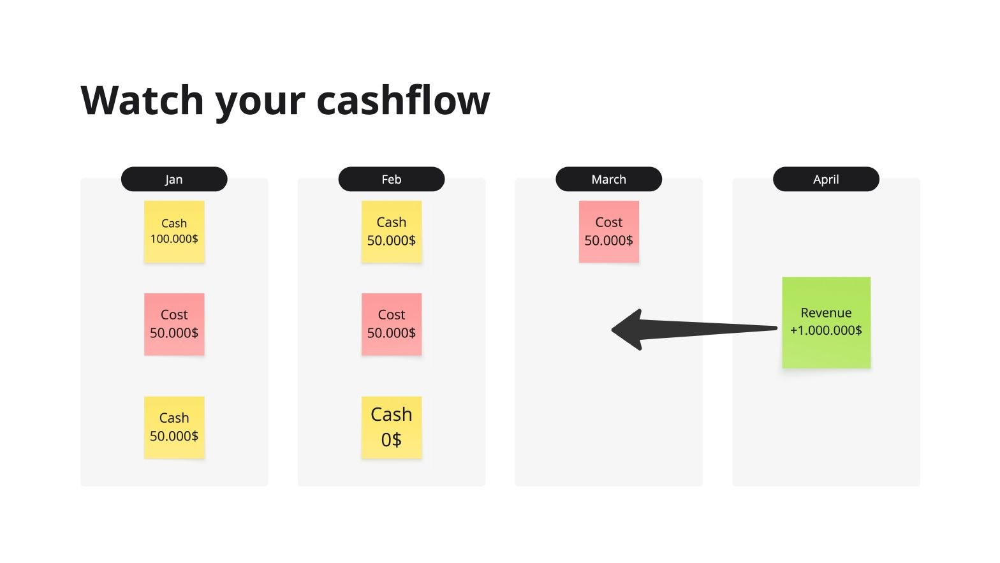

### Watch your cashflow

Jan

Cash  
100.000\$

Cost  
50.000\$

Cash  
50.000\$

Feb

Cash  
50.000\$

Cost  
50.000\$

Cash  
0\$

March

Cost  
50.000\$

April

Revenue  
+1.000.000\$

## Page 9

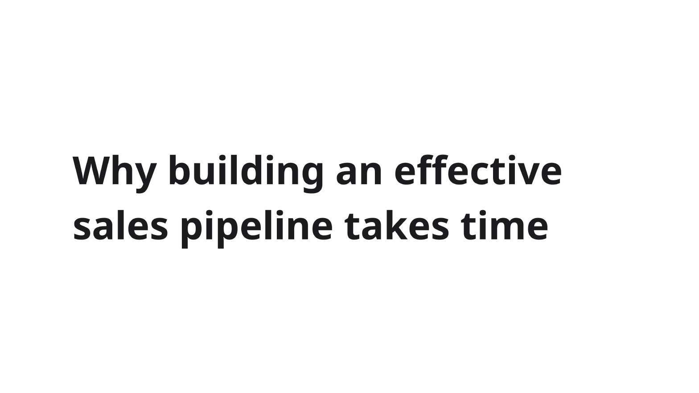

**Why building an effective  
sales pipeline takes time**

## Page 10

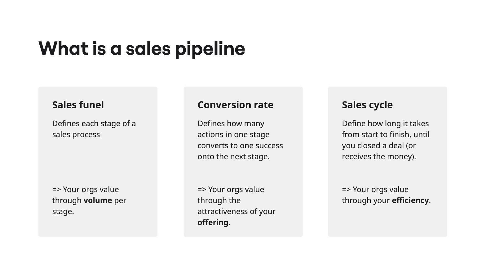

### What is a sales pipeline

#### Sales funel

Defines each stage of a sales process

=> Your orgs value through **volume** per stage.

#### Conversion rate

Defines how many actions in one stage converts to one success onto the next stage.

=> Your orgs value through the attractiveness of your **offering**.

#### Sales cycle

Define how long it takes from start to finish, until you closed a deal (or receives the money).

=> Your orgs value through your **efficiency**.

## Page 11

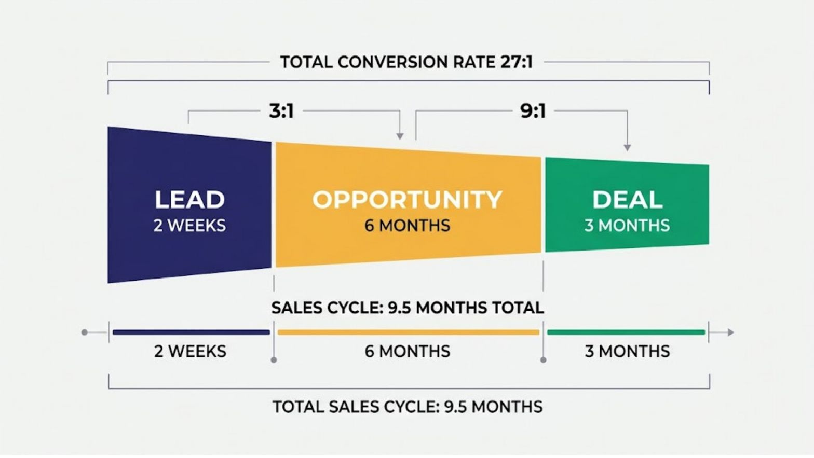

TOTAL CONVERSION RATE 27:1

3:1

9:1

**LEAD**  
2 WEEKS

**OPPORTUNITY**  
6 MONTHS

**DEAL**  
3 MONTHS

SALES CYCLE: 9.5 MONTHS TOTAL

2 WEEKS

6 MONTHS

3 MONTHS

TOTAL SALES CYCLE: 9.5 MONTHS

## Page 12

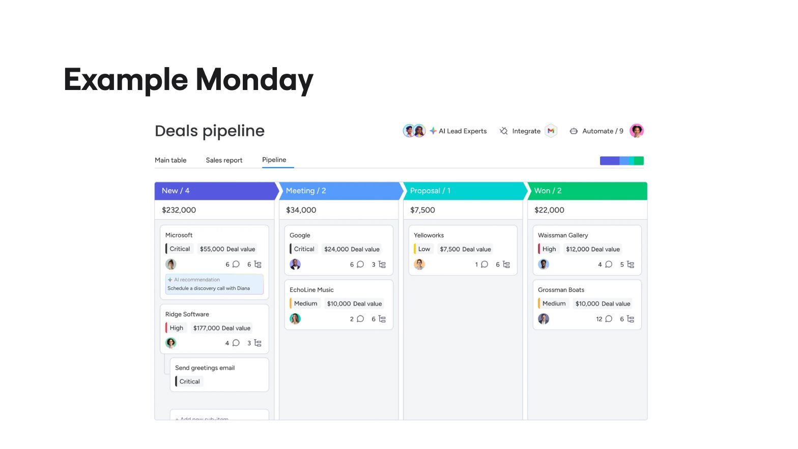

### Example Monday

#### Deals pipeline

Main table      Sales report      Pipeline

## Page 13

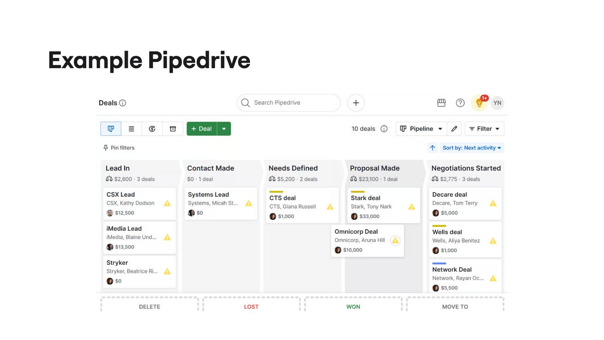

### Example Pipedrive

Deals i

Search Pipedrive

-

YN

- Deal

10 deals i

Pipeline ▼

= Filter ▼

Pin filters

↑ Sort by: Next activity ▼

#### Lead In

\$2,600 · 3 deals

##### CSX Lead

CSX, Kathy Dodson

\$12,500

##### iMedia Lead

iMedia, Blaine Und...

\$13,500

##### Stryker

Stryker, Beatrice Ri...

\$0

#### Contact Made

\$0 · 1 deal

##### Systems Lead

Systems, Micah St...

\$0

#### Needs Defined

\$5,200 · 2 deals

##### CTS deal

CTS, Giana Russell

\$1,000

#### Proposal Made

\$23,100 · 1 deal

##### Stark deal

Stark, Tony Nark

\$33,000

##### Omnicorp Deal

Omnicorp, Aruna Hill

\$10,000

#### Negotiations Started

\$2,775 · 3 deals

##### Decare deal

Decare, Tom Terry

\$5,000

##### Wells deal

Wells, Aliya Benitez

\$1,000

##### Network Deal

Network, Rayan Oc...

\$5,500

## Page 14

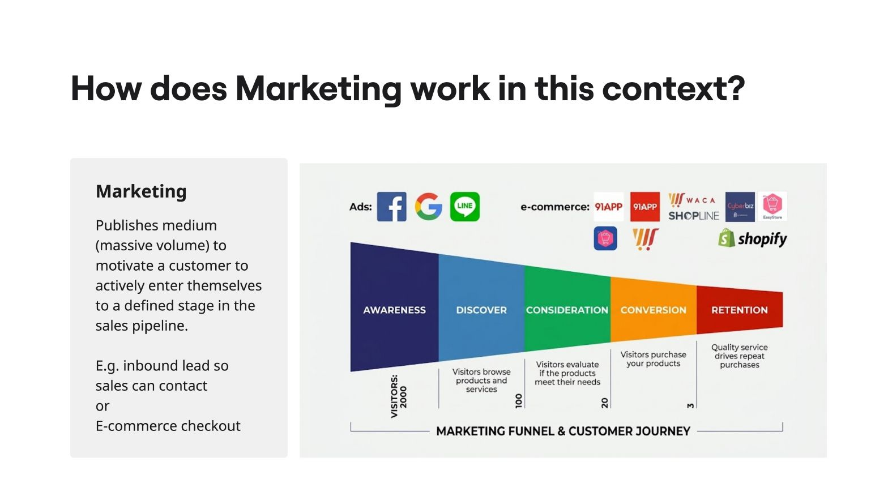

### How does Marketing work in this context?

#### Marketing

Publishes medium (massive volume) to motivate a customer to actively enter themselves to a defined stage in the sales pipeline.

E.g. inbound lead so sales can contact or E-commerce checkout

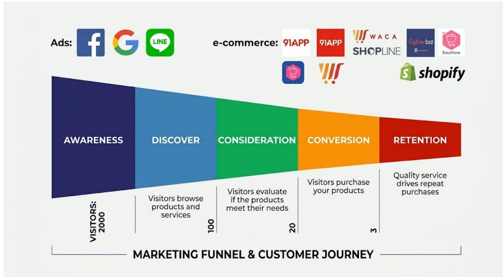

## Page 15

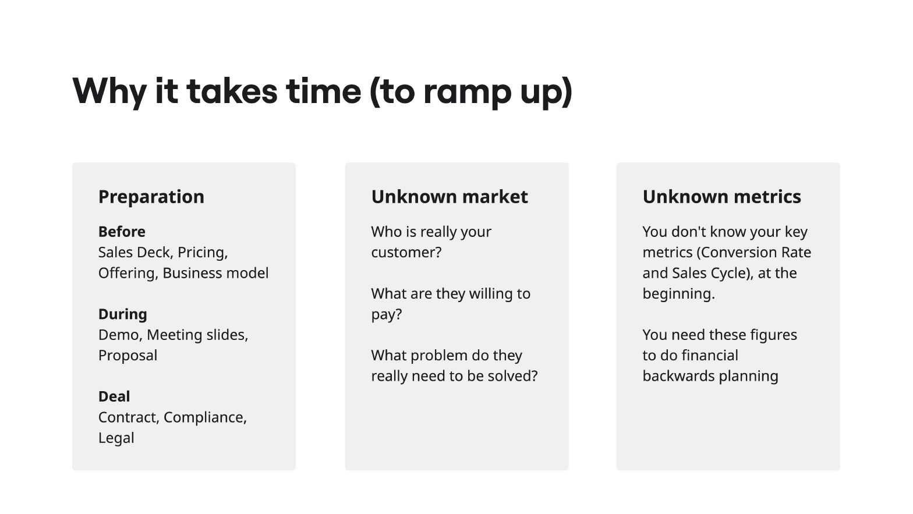

### Why it takes time (to ramp up)

#### Preparation

##### Before

Sales Deck, Pricing,  
Offering, Business model

##### During

Demo, Meeting slides,  
Proposal

##### Deal

Contract, Compliance,  
Legal

#### Unknown market

Who is really your  
customer?

What are they willing to  
pay?

What problem do they  
really need to be solved?

#### Unknown metrics

You don't know your key  
metrics (Conversion Rate  
and Sales Cycle), at the  
beginning.

You need these figures  
to do financial  
backwards planning

## Page 16

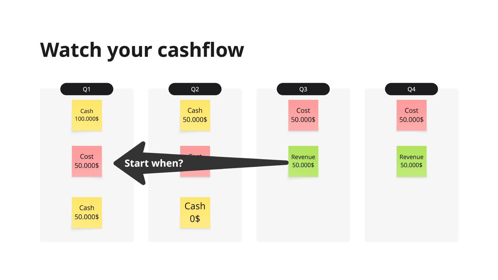

### Watch your cashflow

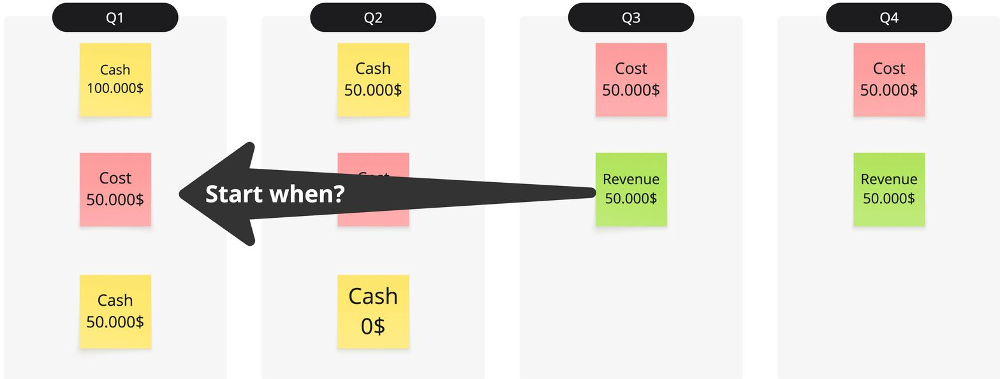
