# CI

Read before touching a husky hook, a workflow in `.github/workflows/`, or the plans in `tools/verify/`. How a change travels from a local commit to a tested `out/` that Cloudflare Pages serves; what Cloudflare does with it, the domain and the headers: `docs/features/hosting.md`. Every command in a box is explained in the [Glossary](#glossary).

**Colour key** (same in every chart):

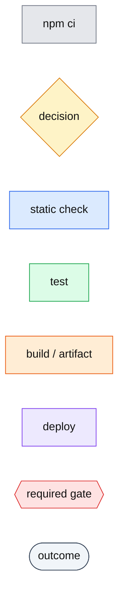

## 1. The process at a glance

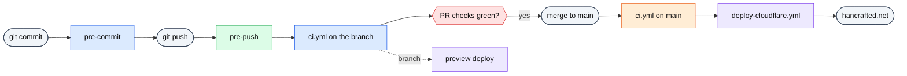

- **Local hooks** catch most failures before anything leaves the machine (section 2).
- **CI on a branch** runs one of two lanes: the full run, or the docs lane when every changed path is Markdown (section 3).
- **`main`** always gets the full run; its tested `out/` is what production publishes (section 4).
- **Scheduled workflows** run beside this, never blocking a merge (section 5).

## 2. Local hooks

### 2.1 pre-commit

`.husky/pre-commit`. Steps on one line run in parallel.

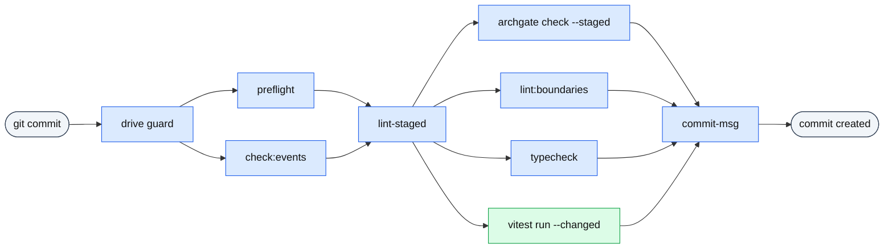

### 2.2 pre-push

`.husky/pre-push` runs `verify:push`: the full `verify` plan, the slow tests the branch reaches, and a build only when the push could change the export. A Markdown-only push still runs the full `verify` and skips only the build, so it is the backstop for a test the CI docs lane's `--changed` misses.

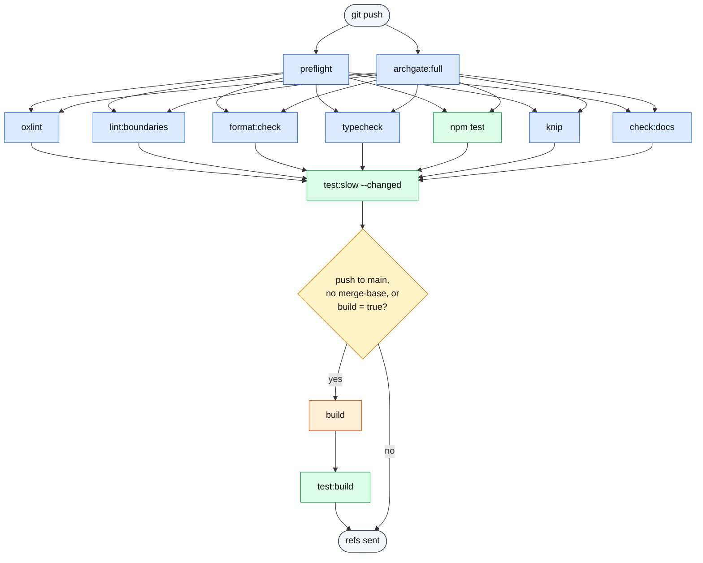

## 3. CI on push (`ci.yml`)

Runs on every push to every branch; a newer push to the same branch cancels the older run. A PR shows the push run on its head commit as its checks.

### 3.1 Job graph

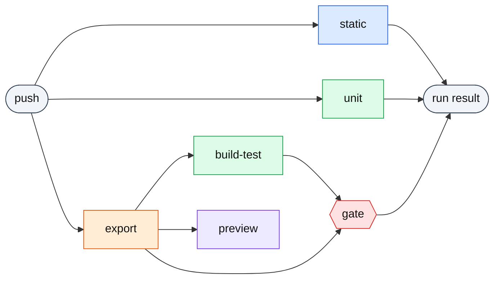

Required checks on `main`: `static` ("preflight, archgate, lint, typecheck"), `unit` ("unit tests") and `gate` ("build, post-build tests").

### 3.2 The change kind

`static`, `unit` and `export` each run `verify:change-kind` after `npm ci`, over the paths changed since the merge-base with `origin/main`. On `main` the step is skipped, so every job takes the full run.

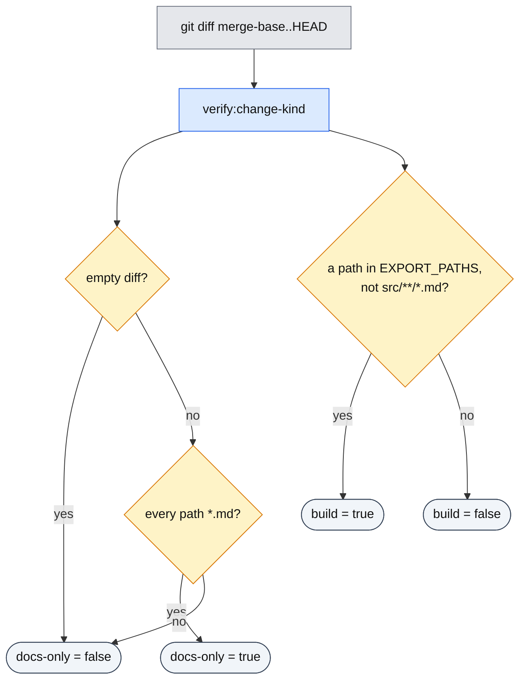

- **`docs-only`** picks the lane: true when every changed path matches `**/*.md`. `markdown-harness.config.yaml` is not Markdown and an empty diff is not a docs change, so both take the full run. The site build reads no Markdown, so the docs lane skips it. `main` always takes the full run, so every successful `main` run holds an `out/` for deploy and rollback.
- **`build`** gates the preview and the local pre-push build: true when a changed path is an export input. The diff is taken against the merge-base, so a branch pushed without a PR works too.
- **Export inputs** live in one place: `EXPORT_PATHS` in `tools/verify/change-kind.pure.ts`, shared by pre-push and the `preview` condition, minus Markdown under `src/` (no build step reads it). Add a path there when the build starts reading it. Its tests fail if `next.config.ts` starts importing `*.md`, if `preview` stops being gated on `export`'s `build` output or on `main`'s exclusion, or if `test:build` moves back into `export`.

| Lane                       | static                                             | unit                    | export         | build-test | preview |
| -------------------------- | -------------------------------------------------- | ----------------------- | -------------- | ---------- | ------- |
| `main`                     | all                                                | `npm test`              | build, 30 days | runs       | never   |
| branch, export input       | all                                                | `npm test`              | build, 1 day   | runs       | yes     |
| branch, other non-Markdown | all                                                | `npm test`              | build, 1 day   | runs       | no      |
| branch, Markdown only      | preflight, archgate:full, format:check, check:docs | `--changed origin/main` | skipped        | skipped    | no      |

### 3.3 static

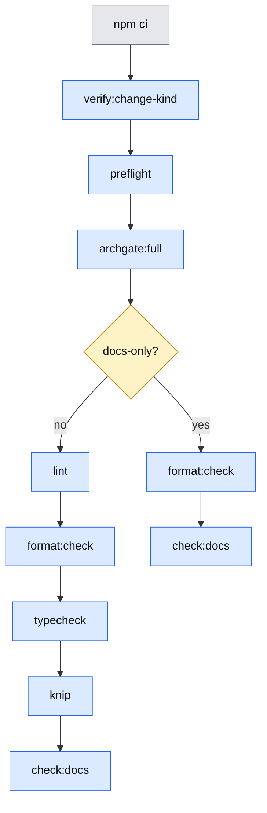

### 3.4 unit

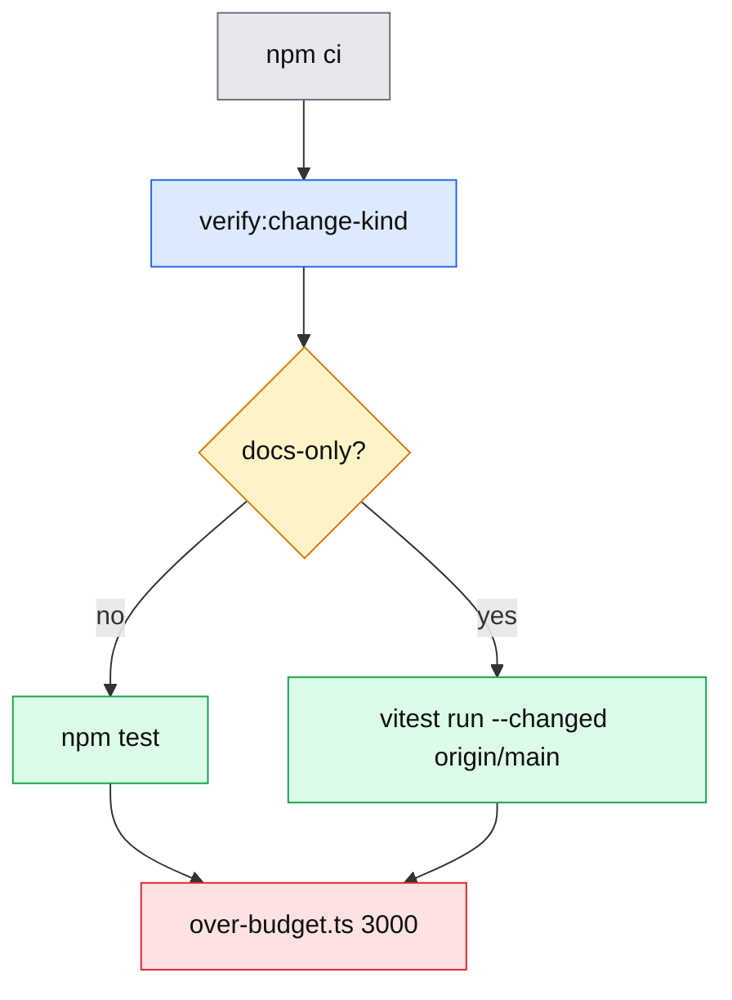

### 3.5 export, build-test and preview

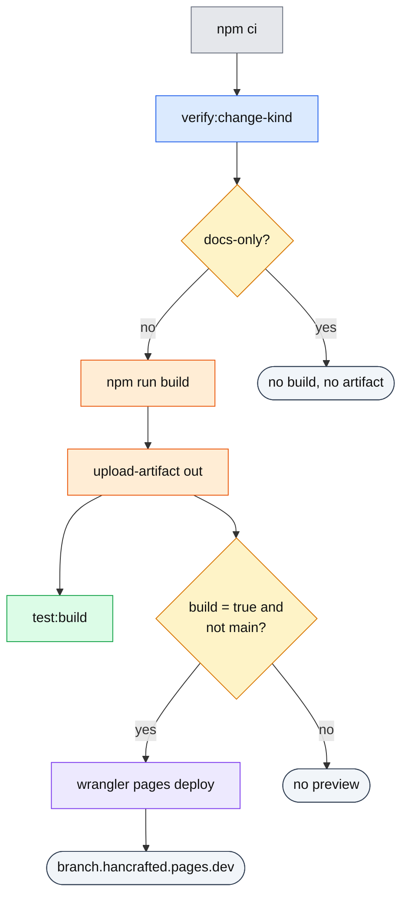

- **export** builds `out/` with an empty `NEXT_PUBLIC_BASE_PATH`, `SITE_URL=https://hancrafted.net` and, on every ref but `main`, `LIST_UPCOMING_EPISODES=true` (what each target shows: `docs/features/hosting.md`). `npm run build` runs `art` first (`prebuild`). It uploads `out/`, hidden files included, kept 30 days on `main` for rollback and 1 day elsewhere, and does not run the post-build suite.
- **build-test** needs only `export`: it downloads `out/`, runs `npm ci` and `npm run test:build` under the same env the build used.
- **preview** needs `export` and runs when `build` is true, the ref is not `main`, the repository is this one (not a fork) and the actor is not Dependabot: forks and Dependabot have no Cloudflare secrets. A branch that changes no export input (docs, skills, tooling) gets no preview. The preview may exist while `build-test` is red; where it lands and when it may go to a client: `docs/features/hosting.md`.

### 3.6 The gate

The `gate` job, named "build, post-build tests" (the context the `main` ruleset requires), needs `export` and `build-test` and runs `if: always()`. It fails unless `export` succeeded and `build-test` succeeded, or was skipped on a `docs-only` push, so a skipped job never stands in for a pass otherwise.

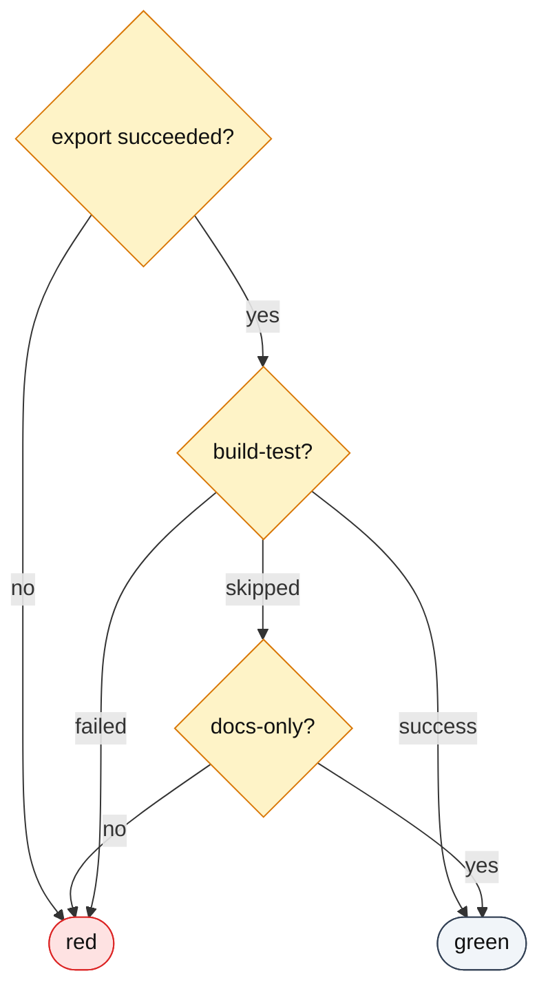

## 4. Production deploy and rollback (`deploy-cloudflare.yml`)

Starts when CI completes on `main`, and only when that run succeeded, so it waits for CI's run on the merged commit. A failed or cancelled CI run deploys nothing, and a newer merge cancels the older one's CI. It never builds: it downloads that run's `out/` (the build CI tested) and publishes it in the `production` environment. A production deploy is never cancelled mid-flight.

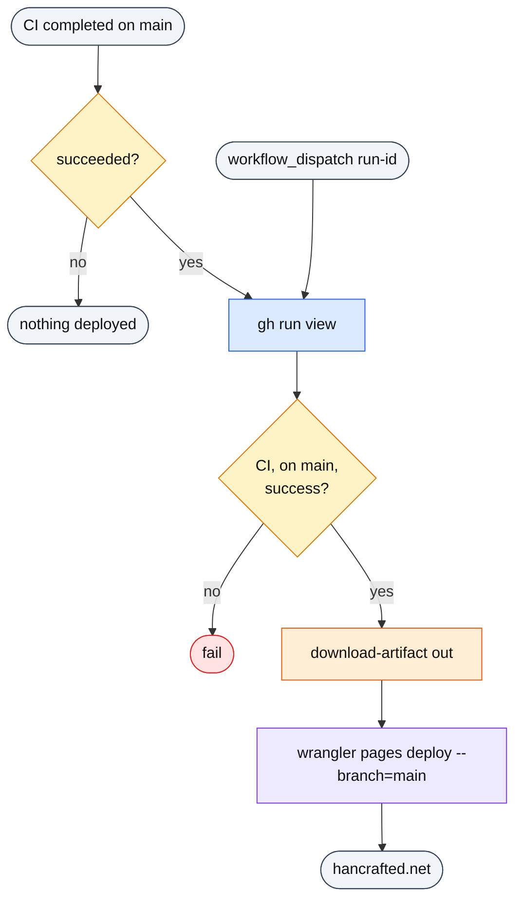

**Rollback:** run the workflow by hand (`workflow_dispatch`). Without a `run-id` it publishes the newest successful CI run on `main`; with one, that run's `out/`, which must be a successful CI run on `main` whose artifact is still inside its 30 days. Redeploying an older run is the rollback.

## 5. Scheduled and side workflows

None of these blocks a merge.

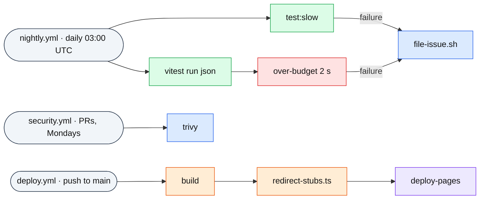

- **nightly:** the whole slow lane and fast-suite timings against a 2 s budget; a failure files a `needs-triage` issue.
- **security:** Trivy over dependencies, config and secrets; reports everything, fails only on real risk.
- **deploy.yml (temporary):** publishes redirect stubs from the old GitHub Pages URLs to hancrafted.net.

## 6. Complete landscape

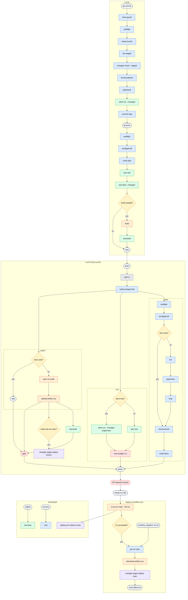

In the landscape, parallel steps of the local plans are drawn in sequence to keep it readable; sections 2.1 and 2.2 show the parallel groups.

## Glossary

| Command                                 | What it does                                                                                                                  | Where it runs                                              |
| --------------------------------------- | ----------------------------------------------------------------------------------------------------------------------------- | ---------------------------------------------------------- |
| `drive guard`                           | Fails a commit that changes a Decision doc (decision records, feature docs, glossaries) on a branch other than `decisions/*`. | pre-commit                                                 |
| `preflight`                             | Checks the checkout itself: `node_modules` is a real folder, the git hooks are installed, archgate can load its rules.        | pre-commit, pre-push, CI static                            |
| `check:events`                          | Fails if an Episode run's `events` log was edited instead of appended to.                                                     | pre-commit                                                 |
| `lint-staged`                           | Runs `oxlint --fix` and `oxfmt` on the staged files only, so the commit is formatted.                                         | pre-commit                                                 |
| `archgate check --staged`               | Runs the ADR rules (`.archgate/adrs/*.rules.ts`) on the staged files.                                                         | pre-commit                                                 |
| `archgate:full`                         | Runs the ADR rules over every file changed since the repo's first commit.                                                     | pre-push, CI static                                        |
| `lint`                                  | `oxlint` (code lint) plus `lint:boundaries`.                                                                                  | pre-push, CI static                                        |
| `lint:boundaries`                       | `depcruise`: fails an import that crosses a forbidden module boundary in `src`, `skills` or `tools`.                          | pre-commit, pre-push, CI static                            |
| `format:check`                          | `oxfmt --check`: fails on any unformatted file, Markdown included.                                                            | pre-push, CI static                                        |
| `typecheck`                             | `next typegen` then `tsc --noEmit`.                                                                                           | pre-commit, pre-push, CI static                            |
| `knip`                                  | Fails on unused files, exports and dependencies.                                                                              | pre-push, CI static                                        |
| `check:docs`                            | `mh check` (markdown-harness: front matter, headings, freshness of governed docs) plus `check:skills` for every skill folder. | pre-push, CI static                                        |
| `commit-msg`                            | The `/commit` gate: Conventional Commits header, `### Added/Changed/…` body, a `Source:` trailer.                             | commit-msg hook                                            |
| `npm test`                              | `vitest run`: the whole fast suite (`*.test.ts`), each test under 3 s in CI.                                                  | pre-push, CI unit                                          |
| `vitest run --changed`                  | Only the fast tests whose imports reach a changed file (plus the rerun triggers in the vitest config).                        | pre-commit (vs HEAD), CI unit docs lane (vs `origin/main`) |
| `over-budget.ts`                        | Reads the vitest JSON report and fails (CI, 3 s) or warns (nightly, 2 s) on tests over the budget.                            | CI unit, nightly                                           |
| `test:slow`                             | `*.slow.test.ts`: tests that take seconds. Pre-push runs those the branch reaches; nightly runs all.                          | pre-push, nightly                                          |
| `npm run build` (`build`)               | `next build` to the static export `out/`; `prebuild` runs `art` (content-hashed Scene art) first.                             | pre-push (when needed), CI export, deploy.yml              |
| `test:build`                            | `*.build.test.ts` against `out/`: every page URL the app derives exists in the export.                                        | pre-push (when needed), CI build-test                      |
| `verify:change-kind`                    | Reads changed paths on stdin and prints `build=` (an export input changed) and `docs-only=` (every path is Markdown).         | CI static, unit, export                                    |
| `verify:commit` / `verify:push`         | The plans behind the pre-commit and pre-push hooks (`tools/verify/verify.pure.ts`).                                           | hooks                                                      |
| `verify` / `verify:quick`               | The full local check (what CI will say) and a fast one for uncommitted changes. Run by hand.                                  | developer                                                  |
| `upload-artifact` / `download-artifact` | Moves `out/` between jobs and workflows; `main`'s is kept 30 days for rollback, a branch's 1 day.                             | CI export, build-test, preview, deploy                     |
| `wrangler pages deploy`                 | Publishes `out/` to Cloudflare Pages: `--branch=<branch>` for a preview, `--branch=main` for production.                      | CI preview, deploy-cloudflare.yml                          |
| `gh run view`                           | Confirms the run to publish is a successful CI run on `main` before deploying it.                                             | deploy-cloudflare.yml                                      |
| `trivy`                                 | Scans dependencies, config and secrets for known vulnerabilities.                                                             | security.yml                                               |
| `file-issue.sh`                         | Opens a `needs-triage` issue when a nightly check fails.                                                                      | nightly.yml                                                |
| `redirect-stubs.ts`                     | Writes one meta-refresh page per exported URL pointing at hancrafted.net, for the old GitHub Pages site.                      | deploy.yml                                                 |
