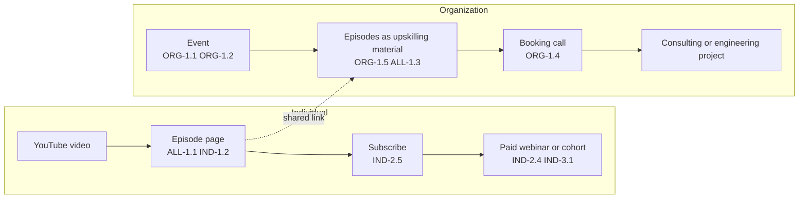

# Product requirements

What each Audience, and Han in his two roles, can do with the content library, per horizon of `docs/steering/product-vision.md`. Who the Audiences are and what each is for lives there; how a capability behaves lives in the spec that refines it.

Each line is one capability in product terms, with a stable id. A spec cites the ids it refines (`Refines ORG-1.2`), so `grep -r ORG-1.2` finds every spec of a capability. An id is retired with its line, never reused. Whether a capability has shipped lives in the code and the closed issues, not here.

Id prefixes: `ALL` every Audience, `ORG` Organization, `IND` Individual, `AUT` Han as author, `MNT` Han as maintainer of this repo.

## Funnels

How the capabilities chain from first contact to each Audience's paid end. Author and maintainer capabilities feed both funnels and are left out.

## Horizon 1: workshops (now to Jan 2027)

### Every Audience

- ALL-1.1 Reach an Episode's learning goal from the Episode alone: its Slides, Speaker notes, sources and video.
- ALL-1.2 Check a claim on a Slide against its source in the Context drawer.
- ALL-1.3 Come back to an Episode as reference material at a URL that does not change.
- ALL-1.4 Read every page in English or German; a link opens in the locale it names, and a German browser is offered the German page.

### Organization

- ORG-1.1 Find Han's Events on one page, each with its date, kind, location and Audience.
- ORG-1.2 Follow an Event's Playlist Episode by Episode, live and afterwards, from one URL.
- ORG-1.3 Watch an Event's recording on the Episodes presented there, labelled with the language spoken.
- ORG-1.4 Book a call with Han, or email him, from any page.
- ORG-1.5 Use Episodes as upskilling material in its own organization, by link.

### Individual

- IND-1.1 Browse every public Episode, filter it by Tag and search it.
- IND-1.2 Watch an Episode's video in my locale on its page.

### Han (author)

- AUT-1.1 Compose an Event from existing Episodes, as they are or adapted as unlisted copies.
- AUT-1.2 Present an Event from its page, with Speaker notes and Voice script at hand.
- AUT-1.3 Keep an Event's attendee pages out of search while their URLs still work.
- AUT-1.4 Add a recording to an Episode with one YouTube id.
- AUT-1.5 Make a new Episode through `/new-episode`, from Brief to a served Episode.

### Han (maintainer)

- MNT-1.1 Review every agent-made change against the recorded decisions (Archgate ADRs, markdown-harness) before it merges.
- MNT-1.2 Reach any fact from `AGENTS.md` in two pointers, found in exactly one place.
- MNT-1.3 Feed a hand fix back into the skill, template or guide that should have got it right.
- MNT-1.4 Turn what agents build in this repo into Episode material on AI enablement.

## Horizon 2: library, evidence and pipeline (2027)

### Organization

- ORG-2.1 See the workshop topics Han offers, each with the Episodes behind it.
- ORG-2.2 Use Explorable explanations in its own training, by link to their own URLs.

### Individual

- IND-2.1 Follow a public Playlist, a series of Episodes in order.
- IND-2.2 Open an Explorable explanation on its own URL and play with it.
- IND-2.3 See the Research questions and Sources an Episode rests on.
- IND-2.4 Sign up for a paid webinar or cohort Han runs, without an account on the site.
- IND-2.5 Hear about new Episodes and Events by subscribing on YouTube.

### Han (author)

- AUT-2.1 Run the content pipeline as a product, first locally, then in the cloud.
- AUT-2.2 Grow the evidence layer by research, on its own schedule.
- AUT-2.3 Promote a Slide to a Shared Slide.
- AUT-2.4 Publish a public Playlist.

### Han (maintainer)

- MNT-2.1 Add a skill, record kind or Shared visual without changing the existing ones.
- MNT-2.2 Trace a Run back through its Jobs, Attempts and Scores to see why it produced what it did.

## Horizon 3: platform (end of 2027)

### Every Audience

- ALL-3.1 Log in and pick up where I left off: Episodes and Playlists I've finished.

### Organization

- ORG-3.1 Give a team's attendees their own access to an Event and its material.
- ORG-3.2 Book and pay for a workshop on the site.
- ORG-3.3 See which of its attendees completed an Event's Playlist.

### Individual

- IND-3.1 Join a paid cohort or webinar on the site, with its live sessions and material in one place.

### Han (author)

- AUT-3.1 Run a webinar from the site.

### Han (maintainer)

- MNT-3.1 Move the site from static pages to an application with a backend, keeping every URL working.
