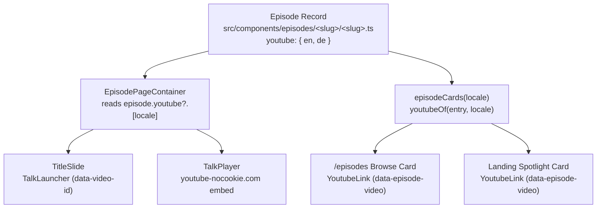

# Episode add YouTube

Adding a YouTube recording to an Episode wires it across three defined surfaces from one declaration on its `EpisodeRecord`:

1. **Title slide launcher**: On `/episodes/<slug>`, the `TitleSlide` renders a `TalkLauncher` button ("Watch the talk") that opens the dockable companion `TalkPlayer` iframe (`https://www.youtube-nocookie.com/embed/<id>`).
2. **Cards on `/episodes` page**: On the browse grid, the Episode's card renders a direct YouTube link button (`[data-episode-video]`, `text-youtube`) opening `https://www.youtube.com/watch?v=<id>` in a new tab.
3. **Landing page spotlight (optional)**: When the Episode is published and featured in the spotlight on `/`, its card displays the same direct YouTube link.

The exemplar implementation is `maintaining-markdown-for-ai`.

## Steps

### 1. Extract the YouTube video IDs

Obtain the 11-character YouTube video ID for English (`en`) and German (`de`):

- If provided as a URL (`https://www.youtube.com/watch?v=...` or `https://youtu.be/...`), extract the 11-character video ID parameter.
- `EpisodeRecord.youtube` is a `PerLocale<string>` requiring both `en` and `de`. When only one recording exists, assign that same video ID to both locales.

_Done when_ both `en` and `de` have an 11-character video ID string.

### 2. Declare `youtube` on the Episode record

In `src/components/episodes/<slug>/<slug>.ts`, add the `youtube` property to the `episode({ ... })` declaration:

```ts
export const myEpisode = episode({
  slug: 'my-episode',
  youtube: { en: 'YxCVw4bUbW0', de: 'YxCVw4bUbW0' },
  messages: { en, de },
  // ...
});
```

_Done when_ `src/components/episodes/<slug>/<slug>.ts` exports `youtube` on the record and `npm run typecheck` passes.

### 3. Update tests and registry assertions

1. In `src/components/episodes/registry.test.ts`, add the recording entry to the `RECORDINGS` table:
   ```ts
   const RECORDINGS = [
     { slug: 'ai-token-economy', en: 'S0Nx4faEebY', de: 'S0Nx4faEebY' },
     { slug: 'maintaining-markdown-for-ai', en: 'YxCVw4bUbW0', de: 'YxCVw4bUbW0' },
     { slug: '<slug>', en: '<id>', de: '<id>' },
   ] as const;
   ```
2. In `tests/post-build/episodes-index.build.test.ts`, if the Episode's status is `'published'`, add its slug to `withVideo`:
   ```ts
   const withVideo = ['maintaining-markdown-for-ai', 'ai-token-economy', '<slug>'];
   ```

_Done when_ `npx vitest run src/components/episodes/registry.test.ts` passes.

### 4. Verify all defined places

Run verification and probe the DOM for the video elements:

1. **Verify pipeline**: Run `npm run verify` to confirm types, lint, unit tests, and Archgate rules pass.
2. **Title slide launcher**: Check `/episodes/<slug>` in preview (`npm run preview` or dev). Inspect that `[data-video-id="<id>"]` exists inside `[data-slot="title-slide"]`.
3. **`/episodes` browse card**: Check `/episodes`. Inspect that `[data-episode-card][data-episode-slug="<slug>"] [data-episode-video]` exists with `href="https://www.youtube.com/watch?v=<id>"`.
4. **Landing page spotlight**: If the Episode is published and ranked in the spotlight, inspect `/` to confirm `[data-episode-card][data-episode-slug="<slug>"] [data-episode-video]` renders on the landing page.

_Done when_ `npm run verify` passes and the DOM probe confirms the presence of `[data-video-id]` on the title slide and `[data-episode-video]` on the browse card.

## Reference

### Architecture and data flow



### Exemplar: `maintaining-markdown-for-ai`

- **Record**: `src/components/episodes/maintaining-markdown-for-ai/maintaining-markdown-for-ai.ts` defines `youtube: { en: 'YxCVw4bUbW0', de: 'YxCVw4bUbW0' }`.
- **Registry test**: `src/components/episodes/registry.test.ts` asserts `maintaining-markdown-for-ai` in `RECORDINGS`.
- **Index test**: `tests/post-build/episodes-index.build.test.ts` includes `maintaining-markdown-for-ai` in `withVideo`.

### Privacy and embed rules

- Post-build check (`tests/post-build/episode-structure.build.test.ts`) verifies no iframe or network request to YouTube is initiated until the user clicks play.
- Embed URLs must use `https://www.youtube-nocookie.com/embed/<id>` with `autoplay=1&rel=0&modestbranding=1` (handled by `TalkPlayerFrame`).
