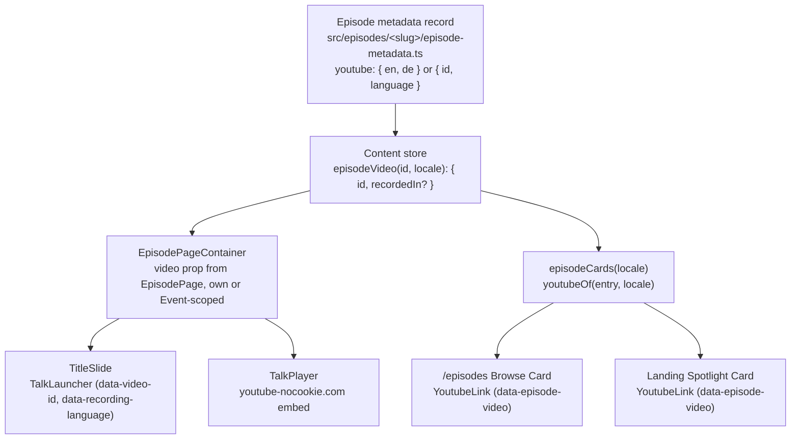

# Episode add YouTube

Adding a YouTube recording to an Episode wires it across three defined surfaces from one declaration on its metadata record, `episode-metadata.ts`, which the content store loads:

1. **Title slide launcher**: On `/episodes/<slug>`, the `TitleSlide` renders a `TalkLauncher` button ("Watch the talk") that opens the dockable companion `TalkPlayer` iframe (`https://www.youtube-nocookie.com/embed/<id>`).
2. **Cards on `/episodes` page**: On the browse grid, the Episode's card renders a direct YouTube link button (`[data-episode-video]`, `text-youtube`) opening `https://www.youtube.com/watch?v=<id>` in a new tab.
3. **Landing page spotlight (optional)**: When the Episode is published and featured in the spotlight on `/`, its card displays the same direct YouTube link.

The exemplar implementation is `maintaining-markdown-for-ai`.

**An unlisted Episode** (`visibility: 'unlisted'`, a composition made for one Event) carries at most one Video instead: the Event recording, one YouTube id with the language spoken at the Event. It plays on both locale pages under the Event, whose launcher labels that language before play ("Recorded in German"); it has no `/episodes/` page and no card link. Follow [The unlisted case](#the-unlisted-case) instead of steps 1 to 3.

## Steps

### 1. Extract the YouTube video IDs

Obtain the 11-character YouTube video ID for English (`en`) and German (`de`):

- If provided as a URL (`https://www.youtube.com/watch?v=...` or `https://youtu.be/...`), extract the 11-character video ID parameter.
- A public Episode's `youtube` holds one video ID per locale, by locale (`en`, `de`); the content store refuses a key that is not a site locale. When only one recording exists, assign that same video ID to both locales.

_Done when_ both `en` and `de` have an 11-character video ID string.

### 2. Declare `youtube` on the Episode's metadata record

In `src/episodes/<slug>/episode-metadata.ts`, add the `youtube` property:

```ts
export const episodeMetadata = {
  slug: 'my-episode',
  status: 'published',
  visibility: 'public',
  // ...
  youtube: { en: 'YxCVw4bUbW0', de: 'YxCVw4bUbW0' },
} as const satisfies EpisodeInput;
```

_Done when_ `episode-metadata.ts` carries `youtube` and `npm run typecheck` passes.

### 3. Update tests and registry assertions

1. In `src/content-store/store.test.ts`, add the recording entry to the `RECORDINGS` table:
   ```ts
   const RECORDINGS = [
     { slug: 'ai-token-economy', en: 'S0Nx4faEebY', de: 'S0Nx4faEebY' },
     { slug: 'maintaining-markdown-for-ai', en: 'YxCVw4bUbW0', de: 'YxCVw4bUbW0' },
     { slug: '<slug>', en: '<id>', de: '<id>' },
   ] as const;
   ```
2. In `tests/post-build/episodes-index.build.test.ts`, if the Episode's status is `'published'`, add its slug to `withVideo`:
   ```ts
   const withVideo = ['maintaining-markdown-for-ai', 'ai-token-economy', '<slug>'];
   ```

_Done when_ `npx vitest run src/content-store/store.test.ts` passes.

### 4. Verify all defined places

Run verification and probe the DOM for the video elements:

1. **Verify pipeline**: Run `npm run verify` to confirm types, lint, unit tests, and Archgate rules pass.
2. **Title slide launcher**: Check `/episodes/<slug>` in preview (`npm run preview` or dev). Inspect that `[data-video-id="<id>"]` exists inside `[data-slot="title-slide"]`.
3. **`/episodes` browse card**: Check `/episodes`. Inspect that `[data-episode-card][data-episode-slug="<slug>"] [data-episode-video]` exists with `href="https://www.youtube.com/watch?v=<id>"`.
4. **Landing page spotlight**: If the Episode is published and ranked in the spotlight, inspect `/` to confirm `[data-episode-card][data-episode-slug="<slug>"] [data-episode-video]` renders on the landing page.

_Done when_ `npm run verify` passes and the DOM probe confirms the presence of `[data-video-id]` on the title slide and `[data-episode-video]` on the browse card.

## The unlisted case

1. Extract the one 11-character video ID, as in step 1, and ask which language was spoken at the Event if the user has not said: `en` or `de`, nothing else.
2. In the copy's record, `src/episodes/by-event/<event-slug>/<slug>/episode-metadata.ts`, add one recording, never a per-locale pair:
   ```ts
   export const episodeMetadata = {
     slug: 'onboard-ai-every-time',
     status: 'published',
     visibility: 'unlisted',
     // ...
     youtube: { id: '<video-id>', language: 'de' },
   } as const satisfies EpisodeInput;
   ```
   The content store refuses a second Video on an unlisted Episode, a per-locale `youtube` on it, and a `language` that is not a site locale.
3. Run `npm run verify`, then `npm run build && npm run test:build`. `tests/post-build/unlisted-episodes.build.test.ts` reads the recording from the store and checks both locale pages of every Episode in its `UNLISTED` table; an unlisted Episode of another Event joins that table first.
4. Probe `/events/<event-slug>/episodes/<slug>/` and its `/de` twin: `[data-slot="title-slide"] [data-video-id="<id>"]` and, inside the launcher, `[data-recording-language="<language>"]` with the label in the page's language.

_Done when_ the post-build test passes and both locale pages show the same video id and the language label.

## Reference

### Architecture and data flow



### Exemplar: `maintaining-markdown-for-ai`

- **Record**: `src/episodes/maintaining-markdown-for-ai/episode-metadata.ts` defines `youtube: { en: 'YxCVw4bUbW0', de: 'YxCVw4bUbW0' }`.
- **Store test**: `src/content-store/store.test.ts` asserts `maintaining-markdown-for-ai` in `RECORDINGS`.
- **Index test**: `tests/post-build/episodes-index.build.test.ts` includes `maintaining-markdown-for-ai` in `withVideo`.

### Privacy and embed rules

- Post-build check (`tests/post-build/episode-structure.build.test.ts`) verifies no iframe or network request to YouTube is initiated until the user clicks play.
- Embed URLs must use `https://www.youtube-nocookie.com/embed/<id>` with `autoplay=1&rel=0&modestbranding=1` (handled by `TalkPlayerFrame`).
